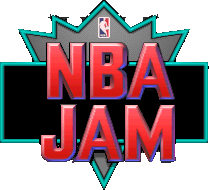
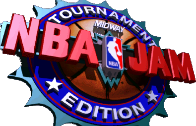
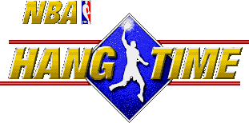
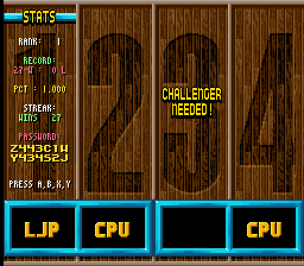

# NBA Jam and NBA Hangtime: Secret Codes and Password Checker

**[Secret codes →](https://maxxthunder.github.io/nbajam/codes.html)** &nbsp; **[Password checker →](https://maxxthunder.github.io/nbajam/)** &nbsp;[](CHANGELOG.md)

<p align="center">
  
  
  
</p>

- **Secret codes**: every secret character and hidden code, read straight from the games and entered in emulators,
  with the ones no published list had marked ★ New:
  - NBA Jam: arcade, Super Nintendo, Genesis, Sega CD, Game Boy, Game Gear.
  - Tournament Edition: arcade, Super Nintendo, Genesis, 32X, Saturn, PlayStation, PC, Jaguar, Game Boy, Game Gear.
  - NBA Hangtime and Maximum Hangtime: arcade, Super Nintendo, Genesis, PlayStation, N64.
- **Password checker** (NBA Jam, and Tournament Edition on Game Boy and Game Gear): type your initials and the
  password, and it tells you whether the game will take them and what record it holds. NBA Hangtime has no passwords.

Contents: [What's on the codes page](#whats-on-the-codes-page) · [What's new here](#whats-new-here) ·
[Password checker](#password-checker) · [Credits](#credits) · [License](#license)

Both pages work offline too: save [`tools/nbajam_codes.html`](tools/nbajam_codes.html) or
[`tools/nbajam_password_checker.html`](tools/nbajam_password_checker.html) and open it in a browser (the codes page
needs `tools/img/` and `tools/audio/` next to it for pictures and sound).

## What's on the codes page

✓ entered in an emulator · ○ read from the game's data, not entered

| Version | Secret characters | Match-up codes | Also |
|---------|:-:|:-:|------|
| NBA Jam: arcade | ✓ | ✓ | tank game, hidden menu and copyright screen, preset records, unused graphics |
| NBA Jam: Super Nintendo, Genesis | ✓ | ✓ | passwords (Super Nintendo), announcer codes (Genesis) |
| NBA Jam: Sega CD, Game Boy, Game Gear | ✓ | ✓ | |
| Tournament Edition: arcade | ✓ | ✓ | hidden menu, preset records, other codes, unused commentary, removed features |
| Tournament Edition: Super Nintendo, Genesis, 32X | ✓ | ✓ | hidden title-menu codes, unused heads, unused courtside ads (Super Nintendo) |
| Tournament Edition: Saturn, PlayStation | ✓ | ✓ | preset records, three cut PlayStation characters |
| Tournament Edition: PC, Jaguar | ✓ | ✓ | Jaguar keypad codes |
| Tournament Edition: Game Boy, Game Gear | ✓ | | |
| NBA Hangtime, Maximum Hangtime: arcade | ✓ | ✓ | joystick codes, trivia contest, rooftop extras, unused graphics |
| NBA Hangtime: Super Nintendo, Genesis | | ✓ | preset records, joystick codes ✓, Genesis options screen ✓ |
| NBA Hangtime: PlayStation, N64 | ○ | ✓ | joystick codes ✓ |

How each one was checked is in the [research notes](docs/).

## What's new here

Codes that no published list had are marked **★ New** on the page. A few terms first:

- **Match-up codes**: buttons pressed on the "Tonight's Match-Up" screen before tip-off, for power-ups and other effects.
- **Preset records**: saved records the game creates for itself; entering their initials opens them.
- **Cut**: something finished in the game's data that no code or menu can reach.

**NBA Jam**
- Arcade: the Secret Midway Menu (a hidden operator screen) and the tank game's reward; the 23 preset records the
  arcade games write into their memory.
- Arcade: two pictures nothing in the game draws, a gold trophy and a Chicago Bulls logo.
- Genesis: initials that play a speech clip (with the clips on the page).
- Sega CD: seven match-up codes no list had.

**Tournament Edition**
- Arcade: Dennis Rodman in two revisions, and the prototype and revision 2.1 birthdays.
- Arcade: name labels for Shaquille O'Neal and Derrick McKey that no revision uses.
- Arcade: the uncensored "Get that shit outta here" plays in the Nani Edition prototype; two announcer calls, "It's
  good!" and "Need to score!", that nothing can play; revisions 1.00 to 2.1 can shatter the backboard; Fatalities
  still works on revision 3.0 2/26 from the right-hand side.
- Title-menu codes on Super Nintendo, Genesis and 32X (a record one team short of the All-Stars, and the 32X's own).
- Super Nintendo: six unused in-game heads besides seven already published.
- Genesis: fourteen unused in-game heads, a set of its own; 32X: four more.
- Super Nintendo, Genesis and 32X: a match-up code the game recognizes and then never uses, probably a cut power-up.
- 32X and PC: 12 of the 32X's 18 match-up codes and 8 of the PC's 19 were on no list.
- Jaguar: a keypad code that clears the cartridge memory, and a random secret character for records that have beaten
  all 27 teams.

**NBA Hangtime and Maximum Hangtime**
- Arcade: a code that turns on four effects at once; the trivia contest's password, which needs a full
  four-quarter game.
- Arcade: M-DOC's PIN is stored so it can't be typed; the published 6-1-6 (max blocking) does nothing; the game has a
  "HOTSPOTS ON" setting with no code to turn it on.
- Arcade: new 1996 Pistons, Timberwolves and Jazz logos that only Maximum Hangtime uses, and an unused DCS Sound
  System logo.
- Arcade: seven red rule captions ("NO PUSHING ALLOWED!", "TOURNAMENT MODE" and others) and two shorter
  "WINNER STAYS ON FREE" notices that no revision draws.
- Arcade: a player animation, five portraits, ten name labels and four badges that no revision points to.
- Arcade: every 100th attract demo is played on the rooftop court, and holding Up + Right at a rooftop tip-off plays
  a "boing" heard nowhere else (Maximum Hangtime keeps it, on its outdoor court).
- Maximum Hangtime: 21 extra NBA players.
- Super Nintendo: two joystick codes no list had, and all eight codes together play the cheat ending.
- Super Nintendo: a bug where entering no match-up number gives your team goaltending and stealth turbo.
- Genesis: an options-screen code that plays the credits, and a published no-arrows code that never takes effect.
- PlayStation and N64: the arcade's joystick codes work there too; M-DOC works on the European N64 cartridge.

**Leftovers** (in the [research notes](docs/secrets.md)): Iguana's crash screen and the Team Player error screen on
Genesis, the Genesis Rev 1 region lock, the Super Nintendo's controller warnings, the Sega CD's cut advert breaks, the
32X Tournament Edition's SH-2 crash screen, a Saturn dunk clip nothing plays, and a Jaguar player slot (BLARG) with no
character behind it.

Things already published elsewhere (the hidden copyright message, the PlayStation cut characters, Steven Tyler's
leftover entry, the beta's dinosaurs) aren't marked new.

Published codes that don't work as printed (wrong buttons, missing presses, codes that do nothing) are corrected on
their cards.

## Password checker

**[Open the checker →](https://maxxthunder.github.io/nbajam/)** Type the initials and password from a game's stats
screen, and it checks them the way the game does and shows wins, losses, percentage, win streak and which of the 27
NBA teams are beaten.

<p align="center"></p>

- **NBA Jam password.** 14 characters hold wins, losses and win streak (8 bits each), the 27 teams beaten, and a
  4-bit checksum, scrambled with a key made from the initials. The Game Boy and Game Gear use the same scheme.
- **Tournament Edition password** (Game Boy, Game Gear). 10 characters hold wins, losses, streak and how far
  along the 27-team ladder you are, with the same initials key. [Both formats →](docs/nbajam_password.md)
- **Why passwords.** The Super Nintendo keeps its 88 records in RAM: they survive a reset but not power-off. The
  Genesis cartridge has an EEPROM, so its stats screen shows `LAST PLAYED` instead of a password.

### Passwords by version

| Game | Passwords |
|------|-----------|
| NBA Jam: Super Nintendo (original and Rev 1), Game Boy, Game Gear | Yes, 14 characters, one scheme: a password works on all of them |
| NBA Jam: Genesis / Mega Drive, Sega CD | None: records are saved |
| Tournament Edition: Game Boy, Game Gear | Yes, 10 characters, a scheme of their own, shared by both |
| Tournament Edition: every other version | None: records are saved |

### If a password won't work

- **Initials.** A password only works with the initials it was made for. The initials are part of its key.
- **Typo.** NBA Jam passwords use `BCDFGHJKLMNPQRSTVWXYZ12345` (no vowels, digits 1 to 5); Tournament Edition uses
  `BCDFGHJKLNPQRTVWXYZ1234567` (no vowels, M or S, digits 1 to 7).
- **All the characters.** The game checks the password when you type the last one. Choosing EX
  before that starts a new record.

### Known passwords

All are valid in the game and decode to the record they were made with.

| Game | Initials | Password | Record |
|------|----------|----------|--------|
| NBA Jam | `LJP` | `Z443C1WY434S2J` | 27–0, streak 27, all 27 teams beaten |
| NBA Jam | `HRY` | `QF3B43TQJY55TF` | 86–0, streak 86, all 27 teams beaten (turns on juice mode) |
| NBA Jam | `RAT` | `12345432123454` | 108–117, streak 173, 18 teams beaten |
| Tournament Edition (Game Boy, Game Gear) | `RAT` | `BZZ6DZ37KY` | 100–7, streak 50, 20 teams beaten |

<details>
<summary><b>Research notes</b></summary>

Everything here comes from disassembling the games and checking the results in emulators: Mesen 2 (Super
Nintendo), BizHawk (Super Nintendo, Genesis, 32X, Sega CD, Game Boy, Game Gear, Saturn, PlayStation, N64, Jaguar),
MAME (arcade) and DOSBox-X (PC).

| Notes | Covers |
|-------|--------|
| [docs/arcade.md](docs/arcade.md) | The original arcade game, plus the arcade sound board, operator menus and code coverage of all three |
| [docs/secrets.md](docs/secrets.md) | NBA Jam on Super Nintendo, Genesis, Game Boy, Game Gear and Sega CD, and the leftovers above |
| [docs/arcade_te.md](docs/arcade_te.md) | Arcade Tournament Edition, all nine revisions |
| [docs/te_consoles.md](docs/te_consoles.md) | Tournament Edition on every home version, including the match-up tables |
| [docs/hangtime.md](docs/hangtime.md) | NBA Hangtime and Maximum Hangtime, arcade and home |
| [docs/variants.md](docs/variants.md) | Betas, prototypes and regional versions |
| [docs/nbajam_password.md](docs/nbajam_password.md) | Both password formats, key, encoder and decoder |

</details>

<details>
<summary><b>Under the hood</b></summary>

The password tools also run from the command line, with Python 3.8 or newer and no ROMs needed
(with no arguments, each runs its self-test):

```bash
python tools/nbajam_password.py LJP Z443C1WY434S2J
```

```bash
python tools/nbajam_te_password.py RAT BZZ6DZ37KY
```

| Path | Contents |
|------|----------|
| `tools/nbajam_codes.html` | The secret codes page |
| `tools/img/`, `tools/audio/` | Portraits, logos and announcer clips for the codes page |
| `tools/nbajam_password_checker.html` | The checker web page |
| `tools/nbajam_password.py` | NBA Jam password decoder and encoder |
| `tools/nbajam_te_password.py` | Tournament Edition (Game Boy, Game Gear) password decoder and encoder |
| `tools/check_checker.py` | Checks that the page's JavaScript agrees with both Python tools (needs Node.js) |
| `tools/check_codes.py` | Decodes every password on the codes page and in the README and checks it against the record it's listed with |
| `tools/nbajam_romcheck.py` | Checks `nbajam_password.py` against the game's own code in Mesen 2 (needs the ROM) |
| `tools/disasm.py`, `tools/reasm.py` | SNES disassembler and reassembler |
| `tools/arcade_gfx.py` | Arcade image decoder for NBA Jam, Tournament Edition and NBA Hangtime: every image in the graphics chips, and which ones nothing points to |
| `tools/iguana_unpack.py` | Unpacker for the original Super Nintendo NBA Jam's packed graphics, with a scan for every block |
| `tools/rnc.py`, `tools/htsnes_soundtest.py` | RNC unpacker for Super Nintendo NBA Hangtime, and a rebuild of its hidden sound-test program as a playable ROM |
| `tools/dis/` | Small disassemblers (68000, SH-2, Z80, SM83, MIPS), a DOS/4GW LE reader, and Game Boy / Game Gear pad-check scanners (need `capstone` for 68000, SH-2 and MIPS) |
| `tools/emu/` | Scripted runners for BizHawk, MAME, Mesen 2 and DOSBox-X (set `EMUHAWK`, `MAME`, `MESEN`, `DOSBOX`) |
| `tools/tests/` | The emulator tests behind the codes page: match-up codes on most versions, cut characters, hidden screens, unused DIP switches, Super Nintendo TE courtside ads and heads, Genesis and 32X TE heads, and NBA Hangtime's names, match-up and joystick codes |
| `disasm/snes/` | 65816 listings of the original ROM, one file per 32 KB bank |
| `disasm/names.txt`, `disasm/entries.txt` | Names for routines and RAM; code addresses seen running in Mesen |
| [CHANGELOG.md](CHANGELOG.md) | What changed in each version |

To rebuild the listings, put `NBA Jam (USA).sfc` in `roms/` (`.gitignore` keeps that folder out of commits):

```bash
python tools/disasm.py "roms/NBA Jam (USA).sfc" disasm/snes
python tools/reasm.py disasm/snes "roms/NBA Jam (USA).sfc"
```

</details>

## Credits

*NBA Jam* and *NBA Jam Tournament Edition* are by Midway; Acclaim published the home versions, and Iguana
Entertainment made the Super Nintendo and Genesis ones. *NBA Hangtime* and
*Maximum Hangtime* are by Midway; Funcom made the Super Nintendo and Genesis versions of NBA Hangtime. Screenshots,
portraits and clips are from the games running in Mesen 2, BizHawk, MAME and DOSBox-X. The ROMs are not included in
this repo.

## License

The code and docs are [MIT](LICENSE). The game logos, portraits, screenshots and announcer clips come from
the games and belong to their owners.
