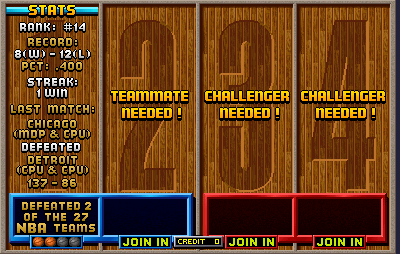
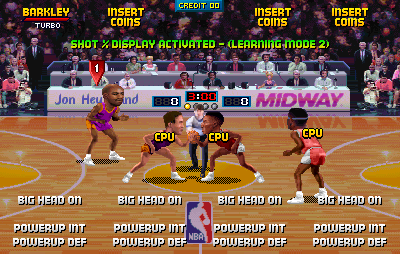
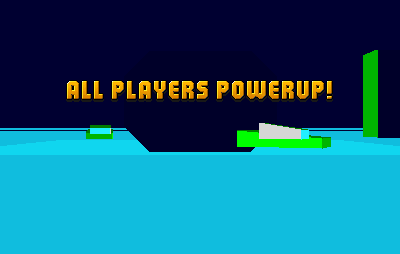
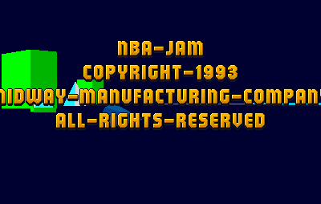
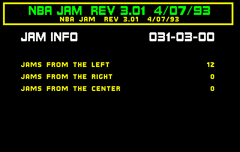
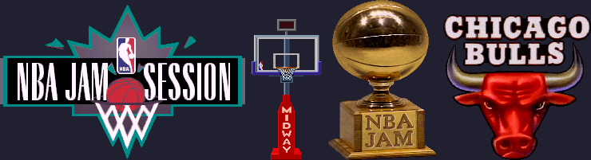

# Arcade NBA Jam: codes in the program ROM

Tournament Edition: see [arcade_te.md](arcade_te.md); for its home versions, [te_consoles.md](te_consoles.md).

What the arcade program (`nbajam`, MAME set) holds for secret characters and matchup codes. The program is
`uj12` (low byte) and `ug12` (high byte) interleaved, mapped at `FF800000` (TMS34010 bit addresses).
Disassembled with MAME 0.282's debugger. The tank game reward and the copyright message were checked in MAME
0.282 with a Lua script driving the inputs and reading RAM.

## Secret characters: nothing new

The initials and birthday table at `FF963740` (rev 3.01) has 13 entries, 5 words each: three letters
(A = 0, `_` = 26), month and day. Revisions 1.00, 2.00 and 3.01 have the same 13, and both prototypes
(1.01 and 2.00) have no table. All 13 are already published:

| Initials | Birthday | Initials | Birthday |
|----------|----------|----------|----------|
| `TWG` | Dec 7 | `GNP` | Oct 8 |
| `RJR` | Jan 17 | `JRN` | Jun 18 |
| `JMC` | Aug 5 | `SNO` | Jan 3 |
| `SAL` | Feb 1 | `HOW` | Jul 15 |
| `SL_` | Jun 24 | `WIL` | Jan 1 |
| `MJT` | Mar 22 | `TON` | Jul 3 |
| `JWH` | Sep 20 | | |

A second table at `FF97F300` (23 entries of 9 words: initials, month, day, games, wins, streak, teams-beaten
mask) is the set of **preset records** the game writes into its CMOS when it's set up. Entering one of them at
the initials and birthday screens opens that record instead of a new one. Ten belong to the secret characters
above (same initials and birthday); the other 13 are plain records:

| Initials | Birthday | Record | Streak | Teams beaten |
|----------|----------|--------|--------|--------------|
| `MDP` | Jan 13 | 8–12 | 1 | 2 |
| `DOZ` | Dec 31 | 9–7 | 1 | 2 |
| `JCV` | Jun 27 | 4–5 | 2 | 1 |
| `JMS` | Feb 22 | 6–10 | 1 | 3 |
| `JFL` | Apr 16 | 7–8 | 1 | 2 |
| `GET` | Oct 19 | 9–11 | 2 | 6 |
| `TJC` | Oct 12 | 9–6 | 4 | 1 |
| `CMM` | Jul 2 | 5–6 | 1 | 3 |
| `WMN` | Nov 11 | 8–7 | 4 | 6 |
| `DIE` | Feb 23 | 2–10 | 1 | 2 |
| `EJB` | Feb 23 | 8–11 | 2 | 6 |
| `CRL` | Jan 1 | 5–0 | 5 | 5 |
| `SAN` | Jan 1 | 5–0 | 2 | 5 |

All 13 checked in MAME on rev 3.01 from a freshly set-up CMOS: each opens its record (every one shows a last match of
Chicago over Detroit, 137–86). Rev 1.00 and Tournament Edition rev 4.0 3/23 have the same 23, and every other revision of both
games has a 23-entry table in the same format (on TE rev 4.0 3/23, MDP and the seven that aren't TE secret characters, JCV, GET, TJC, DIE, EJB, CRL
and SAN, were checked: each opens its record). On a real cabinet a record is only there until the operator clears the CMOS or the
player overwrites it.

<p align="center">
  
</p>

## The tank game's reward (rev 3)

The secret tank game starts from the matchup screen (`FF83D190`) when P1 Down and all three buttons on both
sides are held (`IN0` mask `0x7072`), once per game (`@10E5260`). Your tank has 7 hits of health
(`@10F0E60`), and P1 Shoot fires.

- **If you lose**, it prints "YOU ARE DEAD!" (`FF8E8F30`) and the game goes on to the tip-off.
- **If you survive** until the tank game ends (about a minute), it prints **"ALL PLAYERS POWERUP!"**
  (`FF8E20B0`), sets all four players' power-up level to 8 (`@10F1250`–`@10F1280`) and sets `@10F1290`.

Checked in MAME: holding the code started the tank game. With no input the tank died and "YOU ARE DEAD!" came
up. With its health held at 7 every frame, the tank game ended after about a minute with "ALL PLAYERS
POWERUP!", and RAM showed `@10F1290` = 1 and all four power-up levels at 8.

It also stores `EAEA` in the big-head flags (`@10E59C0`). At tip-off (`FF858EE0`) that value turns on
powerup intercept and big heads for all four players. A power-up level of 8 is powerup defense (see
[Match-up codes](#match-up-codes-rev-301)), and `@10F1290` is the shot percentage display. Checked in MAME: at
tip-off the screen shows BIG HEAD ON, POWERUP INT and POWERUP DEF for every player, and "SHOT % DISPLAY
ACTIVATED - (LEARNING MODE 2)". (The earlier test didn't clear the tip-off help box, so no messages came up.)

Rev 1.00 printed "YOU SURVIVED!" / "YOUR DEAD!" instead and has none of this, so the reward came in a later
revision. I couldn't find it documented.

<p align="center">
  
</p>

## Match-up codes (rev 3.01)

While the Tonight's Match-Up screen is up (`@10F83C0` = 1), a process (`FF907000`) counts each player's new
presses of any button into their power-up level (`@10F1250` + 16 × player). Other processes check the counts
and the stick, and when the tip-off help boxes are gone (`@10E4920` = 0), print the results. All checked in
MAME on rev 3.01.

| Code | Input | Check | Message |
|------|-------|-------|---------|
| Powerup defense | exactly 8 presses | `FF908FD0`; used in play at `FF884520` | POWERUP DEF |
| Powerup intercept | 5+ presses, then hold Down + all three buttons at tip-off | `FF8592F0`: input `0x72`, level ≥ 5 | POWERUP INT |
| Big heads | hold Up + Turbo + Pass at tip-off | `FF859440`: input `0x61` | BIG HEAD ON |
| Shot % display | 15+ presses, with the stick turned through all four directions (any order) | `FF906A80` | SHOT % DISPLAY ACTIVATED - (LEARNING MODE 2) |
| All computer assistance off | exactly 10 presses, with a human on each team | `FF908380`, used at `FF887880` | ALL COMPUTER ASSISTANCE TURNED OFF! |

- **Intercept needs presses.** The 1993 FAQ (v1.17) gives intercept as the hold alone. That leaves the count
  at 0, and nothing happens. The press that starts the hold counts, so 3 presses and the hold (4 in all) fail
  and 4 presses and the hold work. The FAQ's "7 taps then hold" combo
  gives intercept and defense (8 presses in all, as the press that starts the hold counts).
- **No offense power-up.** The FAQ's "Powerup Offense" (21 presses) has no check in the program: the counts it
  tests are 8, 10 and 15 or more.
- **Assistance off with one human.** The flag is set by any player's 10 presses, but the message and the effect
  both need humans on both teams.
- Big heads and intercept toggle (`XOR`), so on a machine with big heads set on, the code turns them off.
  `@10E59C0`/`@10E59D0` hold the big-head and intercept bits, one per player.

**Defense in play.** The only place the game reads power-up level 8 is `FF884560`, deep in the ball-contact routine
`FF883940`: there a level-8 player gets a 70% roll (`FF82DEF0` with 700/1000) that skips `FF8747D0`. With MAME
breakpoints over about 11 minutes of scripted play, the routine ran thousands of times, but the branch that reaches the
check (`FF884490`) never did, so its effect wasn't seen.

**Older revisions.** Rev 2.00 (2/10/93) has the same checks without assistance off (no string, no code), and its
shot % message lacks "- (LEARNING MODE 2)". Rev 1.00 (2/1/93) counts presses (`@10F1130`) and checks only two:
exactly 8 presses (defense, `FF8FBBB0`, also read in play at `FF87A6A0`) and Up + Turbo + Pass at tip-off (big
heads, `FF850900`). It prints no messages. Checked in MAME (`nbajamr2`, `nbajamr1`): on rev 2.00 defense, intercept,
big heads and shot % all set their flags and show their messages; on rev 1.00 defense and big heads set theirs, and
the intercept hold does nothing. This agrees with the FAQ, which says assistance off needs version 3.0.

**Prototypes.** Prototypes 1.01 (1/23/93) and 2.00 (1/24/93) have only the big-heads check (and the first step of the
hidden menu code): no press counter, no tank game, no copyright screen. Big heads checked in MAME on 1.01 (`nbajamp1`).
They also have an operator head-size setting ("SMALLEST SIZE: 1" to "LARGEST SIZE: 5") that the releases replace with
the big-head adjustment.

## Other input checks

Every read of the input ports (`@1600000h`-`@1600030h`) and of the per-player switch words (`@10E5350h` + 16 ×
player) in rev 3.01 was listed, with the test that follows. Apart from the codes on this page they are coin and
start handling, the operator test screens (holding both Starts leaves the switch test) and ordinary play. TE rev 4.0
3/23 (`@10E62E0h`) gives the same result. So there are no other button codes in either game.

**DIP switches.** The switch word (`@1600030h`) is read in two places: the bill-validator check at power-on (raw bit
6) and `FF9BD000h`, which inverts it and reverses the bits of each byte. Each caller of that routine tests one
setting, and they cover only the settings the operator menu names: test switch, power-up test, show/skip video,
validator, 2 or 4 players, coin counters, country, coinage and coinage source. The menu itself (`FF9BB6B0h`) labels
the other three switches (raw `0x04`, `0x08`, `0x10`) "UNUSED", and nothing else reads them. TE rev 4.0 3/23 has
the same callers without the video check, so four switches are unused there. These match MAME's names.

A read tap in MAME on rev 3.01 finds two more reads, neither one a setting. The input interrupt (`FF826BB0h`) copies
`@1600000h`-`@160003Fh` into its current/previous/newly-pressed tables at `@10755B0h`, `@1075570h` and `@10755F0h`,
so the switch word rides along in the upper half of each, but nothing reads that half. `FF837370h` reads a bit field
starting at `@1600029h` that only overlaps the switch word. The operator's switch screen also reads the whole word
(`FF9BAFC0h` stores it, `FF9BB450h` redraws when it changes). Tested: each of the three switches on from power-on,
gives screens identical pixel for pixel to the default run from the same NVRAM, and flicking each on for 30 frames
during attract mode (`0x04` also for 3, 8 and 900 frames) does nothing either. Runs have to start from the same
NVRAM: on fresh NVRAM the board stops on "CMOS INVALID -- FACTORY SETTINGS RESTORED", and comparing against such a
run first looked like the switches gave a free credit.

## Hidden copyright message

If you also hold **P1 Right, P2 Right, P2 Shoot and P2 Turbo** (MAME's names; `IN0` mask `0x5808`) as the
tank game starts (`FF8E1F10`), the tank game is replaced by a screen that plays sound `$109` and shows four lines
(`FF8F51B0`). They're stored encrypted: each byte has a key subtracted, starting at 2 and growing by `$25`.

```
NBA-JAM
COPYRIGHT-1993
MIDWAY-MANUFACTURING-COMPANY
ALL-RIGHTS-RESERVED
```

Checked in MAME: the message stays up over the tank scenery for a few seconds, then the game goes on to the
tip-off with no reward. It's likely a hidden ownership mark against bootleg copies.

<p align="center">
  
  
</p>

## Hidden stats menu (rev 3.01)

Rev 3.01 has the same hidden operator menu as [Tournament Edition](arcade_te.md#secret-midway-menu), with
the same two codes:

1. In attract mode, after any button press, hold Up and all three buttons on both P1 and P2 (`IN0` `0x7171`),
   then switch to holding only both Downs (`0x0202`) until a 53-frame timer runs out (`FF9995B0`). The
   credits start (process `FF9D40A0`).
2. During the credits, press P1 Turbo ×2, P2 Shoot ×3, P2 Pass ×2, P1 Shoot, P1 Pass, P2 Turbo ×2
   (sequence at `FF9217E0`).

After the credits, it shows "NBA JAM REV 3.01 4/07/93" and the `JAM INFO` page (jams from the left, right
and center). Button presses step through an audit page, the score and team stats, and the records table,
then return to attract mode. Revisions 1.00 and 2.00 don't have it.

Checked in MAME: both codes entered as above brought up the menu and all its pages.

<p align="center">
  
</p>

## Unused graphics

`tools/arcade_gfx.py` decodes the arcade images. The program ROM (uj12/ug12, bit address `FF800000`) holds 18-byte
image headers: width, height, x and y anchor (words), a bit offset into the graphics chips (from `02000000`; the 16
chips form four 2 MB banks of ug/uj/ug/uj bytes), a control word (bits 12-14 bits per pixel, 0 meaning 8; bit 7 a skip
byte at the start of each row) and a palette pointer (a word count, then 15-bit colours). The format was worked out by
logging the blitter's registers in MAME (`01A80010` command, `01A80020`/`30` offset, `01A80060`/`70` size) and finding
the same values in the program ROM. The scan finds 3,557 headers in rev 3.01.

The images are drawn through header pointers, through lists of them, or (for backgrounds) through records that hold
the graphics offset directly. Six headers (four pictures; the hoop is three pieces) have none of these: nothing points
to the header, and the graphics offset appears only in the header itself. None was drawn in 36,000 frames (10 minutes) of attract mode in MAME,
with every blitter offset logged. They sit together at `FFA4CB30`-`FFA4CE00`:

- **NBA Jam Session logo** (`FFA4CB30`, 307 × 196), already published.
- **Front-on hoop** (`FFA4CBC0` shot clock, `FFA4CC50` backboard, `FFA4CCE0` MIDWAY stand), already published.
  Put together by their anchors they make one 88 × 177 hoop.
- **NBA Jam trophy** (`FFA4CD70`, 136 × 201). Tournament Edition rev 4.0 has the same picture with its header pointed
  to (`FFAB85B0`).
- **Chicago Bulls logo** (`FFA4CE00`, 185 × 183). Its palette is also in a list of palettes at `FF9FB850`; the image
  itself is never pointed to.

<p align="center">
  
</p>

The scorer's-table ads (Recycle, Midway, MK II, NBA Jam Session, Tortorice's Pizzeria, Cheer-Accident, Jon Hey Band
and others) all come up. `FF845460` picks a random 0-7 for the left boards and indexes two lists of eight header
pointers (`FF8458F0`, `FF8459F0`), then a random 0-6 for the right boards and two lists of seven (`FF845AF0`,
`FF845BD0`). The random routine (`FF82DE00`) multiplies a 32-bit random number by n + 1 and keeps the high word, so it
returns 0 to n and every entry can be picked. MAME's debugger (`-debug -debugger none`, then `dasm` from Lua) gave the
listing.

## Operator-menu leftovers

NBA Jam, Tournament Edition and NBA Hangtime share Midway's operator code, and some of it belongs to other games.

- **NBA Jam has a "LIVES PER PLAY" adjustment** (2 to 7 lives, factory setting 3; record at `FFB782C0`, help text "THE
  NUMBER OF LIVES A PLAYER RECEIVES EACH TIME HE STARTS OR CONTINUES A GAME"). The adjustment list skips its record,
  so the GAME ADJUSTMENT screen never offers it (checked in MAME on rev 3.01). The "AUTO H.S. RESET" record isn't in
  the list either.
- All three games keep help text for a graphic-violence setting ("THIS ALLOWS THE GRAPHIC VIOLENCE SHOWN ON SCREEN TO
  BE ADJUSTED", with NORMAL and LESS VIOLENT choices in NBA Jam), and nothing points to it. Tournament Edition and NBA
  Hangtime also keep the lives help text with nothing pointing to it.
- NBA Jam keeps a LOCKUPS audit name. Neither audit page shows it (checked in MAME), and neither does the hidden
  menu's audit page.

## Sound board

The sound board (a 6809 with a YM2151, a DAC and an OKI6295) is the same in NBA Jam and Tournament Edition. The main
CPU sends one byte at a time to `@1D01030h`, as a word with `$FF` in the high byte: bit 8 low holds the board in reset.
Commands from `$100` up are sent as `$7A` and then the low byte (`FF952320h` in TE rev 2.1); `$7A` switches to a second
command table, and other prefix bytes are ignored. In the sound CPU's space the OKI chip is at `$2C00` and its bank
register at `$3400`, where the values 3, 2, 1, 0, 7, 6, 5, 4 select the 128 KB banks 0 to 7 of `u12`/`u13`.

The sound program (`u3`) keeps its tables behind pointers at `$4001`-`$401F`. Speech goes through two lists of 5-byte
records (`$4015` and `$401F`): OKI bank, a type byte (below 2 means switch banks first), phrase number and length. NBA
Jam has 361 records and Tournament Edition 288. Between them they point to every sample in the OKI phrase tables
except two, which are the same two in both games: **"It's good!"** (bank 2 phrase `$3A` in NBA Jam, `$38` in TE,
1.11 s) and **"Need to score!"** (bank 4 phrase `$28`, `$27` in TE, 1.30 s). Nothing can play a sample that has no
record, so the announcer never says either.

Commands are listed at `$400F` (and `$4019` for the `$7A` page) as a type and a parameter. Types 7 and 18 start
speech: the parameter picks a script from `$400B` or `$401D`, a channel byte followed by (record, volume) pairs ending
in `$FF`, which play records from the `$4015` or `$401F` list in turn. Following every command's script shows which
samples a command can play: all of TE's except the two above, and all of NBA Jam's except those two and a 0.04 s
sample (bank 5 phrase `$34`). TE's published commands for its unused "Get that…" line are real: `7A B5` plays
records `$49`, `$5B`, `$5C` (the censored version) and `7A C9` plays `$49`, `$62`, `$5C` (uncensored); see
[arcade_te.md](arcade_te.md#unused-commentary).

Testing commands from MAME's Lua needs both bytes of a `$7A` command sent within a few milliseconds: the sound program
waits only that long for the second byte (`$FA2D` in the sound program), and Lua can only write once per frame, so in such a test the second
byte runs as an ordinary command. Sent that way, all 512 commands, eight times each, played the same phrases every
time (130 distinct samples on NBA Jam, 116 on TE), so the program has no randomness. Three games of random play raised
that to 183 of 297 samples (NBA Jam) and 176 of 275 (TE), all of them among the ones the scripts can reach.

## Code and image coverage

A single MAME read tap over the whole program ROM sees every instruction fetch: about 5 million per second of game
time, at about 100 frames per second of real time. (Installing several narrow taps in the same address space doesn't
work: they never fire, so use one wide tap and filter by address.) Four 170,000-frame runs of random four-player input
per game logged every fetch and every blitter offset:

| Game | Call and jump targets that ran | Pointed-to images drawn |
|------|--------------------------------|-------------------------|
| NBA Jam rev 3.01 | 498 of 869 (57%) | 1,787 of 3,079 (58%) |
| Tournament Edition rev 4.0 3/23 | 525 of 848 (62%) | 1,816 of 4,207 (43%) |
| NBA Hangtime L1.3 | 607 of 1,198 (51%); 690 (58%) with save-state runs | 155 more than all the earlier runs ([hangtime.md](hangtime.md#not-covered)) |
| Maximum Hangtime L1.03 | 630 of 1,185 (53%), save-state runs included | 2,896 of 7,062 (41%) |

The routines that never ran are the operator menus and hardware tests, the CMOS error screens, the beat-all-27-teams
ending, the credits, and in the Hangtime games the create-player, record, trivia and sweepstakes screens. None of them is an unknown
feature.
