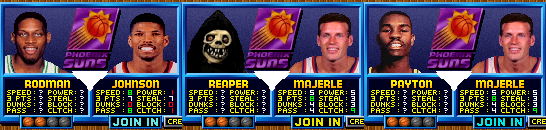
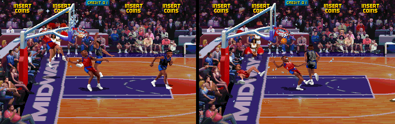
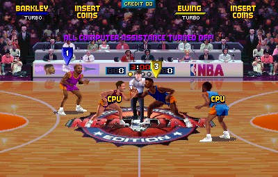
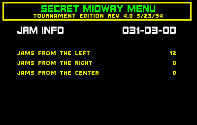
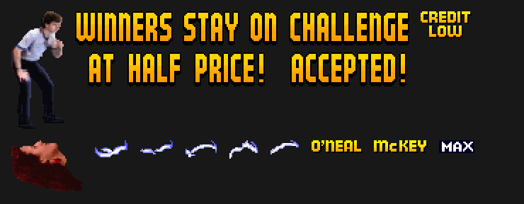
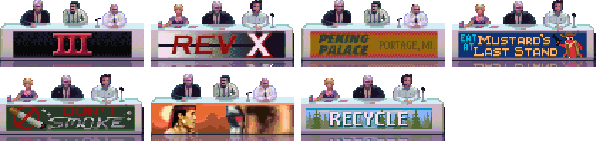
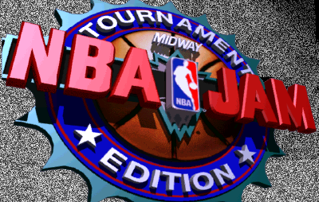

# Arcade NBA Jam Tournament Edition: codes in the program ROM

What the TE program ROMs hold for secret characters and hidden screens, across all nine sets in MAME's
`nbajamte.zip`. As with [the original](arcade.md), the program is `uj12` (low byte) and `ug12` (high byte)
interleaved, mapped at `FF800000`, and was disassembled with MAME 0.282's debugger. Everything marked
*checked* was entered in MAME 0.282 through the game's own initials and birthday screens, with a Lua script
driving the inputs.

Published lists compared against: GameFAQs, the arcadecontrols.com code thread and the Johnny Joystick Retrogaming list
(both list the same 61 codes for the final revision, plus the 8 removed after revision 2).

## Secret characters

The table at `FF9DF760` (rev 4.0 3/23/94) has 5-word entries: three letters (A = 0, `_` = 26), month and
day. The check at `FF9DF380` runs only when the "hidden characters" adjustment (`#$1C`) is on, stops at the
first match, and puts the entry's number in the player's character slot.

| Set (MAME name) | Revision | Table | Entries checked | Differences from the published codes |
|-----------------|----------|-------|-----------------|--------------------------------------|
| `nbajamtep2` | proto 2.00 12/17/93 | `FF9C9280` | 56 | placeholder codes, see below |
| `nbajamte1` | 1.00 1/17/94 | `FF9DC890` | 69 | none |
| `nbajamte2a` | 2.0 1/28/94 | `FF9DC400` | 69 | none |
| `nbajamte2` | 2.1 2/06/94 | `FF9DC400` | 69 | **5 removed characters have new birthdays** |
| `nbajamte3a` | 3.0 2/26/94 | `FF9E0450` | 69 | **all staff codes disabled** |
| `nbajamte3` | 3.0 3/04/94 | `FF9DF510` | 61 | **`ROD` replaces `BRK`** |
| `nbajamte4` | 4.0 3/03/94 | `FF9DF510` | 61 | **`ROD` replaces `BRK`** |
| `nbajamte` | 4.0 3/23/94 | `FF9DF760` | 61 | none |
| `nbajamten` | Nani Edition 5.2 8/11/95 | `FF9E0A20` | 61 | **`GEE` replaces `ZEK`** |

The 61-entry tables have a 62nd entry, a second copy of `KRL` 7/24, which the loop never reaches.

### Not on the published lists

All checked in MAME.

- **Dennis Rodman: `ROD`, May 13** (revs 3.0 3/04 and 4.0 3/03). These two revisions have Rodman in place
  of Charles Barkley. The published lists only say that `BRK` doesn't work on 3.0/4.0. It does work again on
  4.0 3/23, the last revision (checked).
- **Rev 2.1's codes for the removed characters.** Rev 2.1 changed five of the eight birthdays, so the
  published codes for them fail on it (`SUB` 12/5 and `GRM` 10/31 checked):

  | Character | Revs 1.00 and 2.0 (published) | Rev 2.1 |
  |-----------|-------------------------------|---------|
  | Grim Reaper | `GRM` Oct 31 | **`BIG` Sep 31** |
  | Sub-Zero | `SUB` Dec 5 | **`SUB` Nov 5** |
  | Kongo | `KNG` Jan 16 | **`KNG` Mar 26** |
  | Scorpion | `SCO` Jul 6 | **`SCO` Jul 5** |
  | Reptile | `RPT` Nov 11 | **`RPT` Nov 10** |

  Elviscious (`ELV` Jan 8), Raiden (`RAD` Jul 9) and Tim Coman (`TJC` Oct 11) are unchanged. The birthday
  screen offers day 31 for every month, so Sep 31 can be entered.
- **Rev 3.0 2/26 has only the 13 NBA players.** It keeps all 69 entries, but 17 is added to the first
  letter of every staff and removed-character entry, so they can never match. `MJT` 3/22 and `TWG` 12/7 fail;
  `PIP` 9/25 works.
- **Two GameFAQs typos.** GameFAQs lists Eugene Jarvis as `EPG` and Vince Pontarelli as `VJB`. The table
  has `EPJ` 1/27 and `VJP` 4/11. `EPG` and `VJB` fail on rev 4.0 3/23; `EPJ` and `VJP` work (checked).
- **Isiah Thomas works on rev 1.00.** One published list says `ZEK` 4/30 doesn't work on 1.0/2.0, but rev
  1.00 has it and shows Thomas.
- **Gary Payton: `GEE`, Jul 23** (Nani Edition prototype). Payton takes Isiah Thomas's place.
- **Prototype 2.00 placeholders.** The December 1993 prototype has 56 entries. It has none of the 13 NBA
  players. Several staff are in it under placeholder initials with a Jan 1 birthday:
  `JZG` (Gentile), `RZM` (Macika), `WZD` (Davis), `BZD` (Dabelstein), `JZL` (Linhoff), `KER` (Hoskins) and
  `LOR` (Olivia). `LOR` and `KER` were typed in MAME on `nbajamtep2`: team select shows Olivia and Hoskins with
  their portraits.

<p align="center">
  
</p>

## Match-up codes

The Tonight's Match-Up code (`FF937E50`–`FF939360`, rev 4.0 3/23) counts each player's presses of any button
(`@10EB160` + 16 × player) and watches the stick. When the tip-off help boxes are gone, separate processes print
the results (`FF939390`). All checked in MAME on rev 4.0 3/23.

| Code | Input | Notes |
|------|-------|-------|
| Powerup G.T. | exactly 24 presses | |
| Shot % display | 15+ presses while turning the stick through all four directions | GameFAQs' "all three buttons 7 times" fails; holding all three with Down or Right triggers Max Power or Tournament Mode instead |
| Max Power | hold Down + all three buttons | Start isn't checked |
| Tournament Mode | hold Right + all three buttons | sets `@10EB1C0`, clears secret characters, cancels everything else |
| Big Head / Huge Head | hold Up + Turbo + Pass at tip-off (`FF876220`); Huge with exactly 6 presses | |
| Quick Hands | 5+ presses, hold Down + Shoot at tip-off | |
| Baby size | hold Down-Right; Pass, Turbo, Shoot ×3 (table `FF93E180`) | the table holds button bits 4, 1, 2 three times (Turbo = 1, Shoot = 2, Pass = 4, read at `FF9DA700`); published lists give Turbo, Shoot, Pass. Success sets `@10EAAA0`, and tip-off shows "BABY SIZE PLAYERS" |
| **All computer assistance off** | **exactly 10 presses, with a human on each team** (`FF93A640`) | not on any published TE list |

Baby size wasn't completed in MAME: the check (`FF93DEE0`) matched the first eight presses in order, but the ninth
never reached the game's input state. The codes page's screenshot was taken with `@10EAAA0` set during Tonight's
Match-Up, which is what the check sets on success.

Also checked: **Fatalities** (team select, hold Up and press Pass 20 times) works on revs 1.00, 2.0 and 2.1, on
3.0 2/26 from the right-hand side only (below), and not on 3.0 3/04, 4.0 3/03 or 4.0 3/23. **Team Swap** (halftime substitutions, hold Right + Pass) shows
"TEAM SWAP ENABLED!" on rev 4.0 3/23.

The code for Fatalities is still there in the later revisions; jumps were added to skip it. Each side of team select
has its own check, and both lead to "FATALITIES ENABLED!" (`FFAA3FA0` in rev 2.1). Rev 3.0 2/26 adds a jump over one
of them (`FF9C2460`, the left-hand team's) but not the other (`FF9C51A0`-`FF9C5250`, the right-hand team's), and rev
3.0 3/04 skips both. **So Fatalities still works on rev 3.0 2/26 from players 3 and 4**, which the published lists
don't say. Checked in MAME: from P3, holding Up and pressing Pass shows "FATALITIES ENABLED!"; from P1 the count
reaches the check and the jump skips it. The count only starts once the team-select screen is fully up, so
presses made while it's still appearing don't count.

## Backboard shatter (revs 1.00 to 2.1)

Revs 1.00, 2.0 and 2.1 can shatter the backboard; so can the December prototype and the Nani Edition. Rev 3.0 2/26
added a jump (`FF8A3FD0`) that skips the check, and both 3.0s and both 4.0s have it. In rev 2.1 (`FF8A41A0`-`FF8A4800`,
run after a made basket):

- Each team keeps a count (`@10EAC80`, `@10EAC90`) that rises on some of its baskets. At a checkpoint between periods
  (`FF890E10`), a count of 3 or more becomes a countdown of count − 2 baskets.
- In the 4th quarter or overtime (`@10EAE80` ≥ 3), the basket that ends the countdown breaks the backboard if all of
  these hold:
  - it's one of 15 dunks (list at `FF8A4810`);
  - the dunker is a human player (`@10E62D0` holds the players who pressed Start);
  - no backboard has been broken yet (`@10EAC20`);
  - the dunker's rating at +`$40` is 9 or more.
- The glass then breaks (process `FF8AA9F0`, sound `$2300`), a `$20` timer is set on two players (+`$430`) and
  `@10EAC20` records the team.

Checked in MAME on rev 2.1 by forcing the quarter, the countdown, the human-player test and the rating: the next dunk
from the list broke the backboard and players fell. It wasn't seen in unforced play.

<p align="center">
  
</p>

<p align="center">
  
</p>

**Location-test message.** The December 1993 prototype (proto 2.00 12/17/93) has text the releases don't: "ATTENTION
CHICAGO: WE HAVE CHOSEN THIS ARCADE FOR OUR FIRST TEST OF THE NEW NBA JAM - TOURNAMENT EDITION!", saying the game will
be updated every few days through Christmas, records will be saved as it's updated, and asking players for ideas on
how to improve it. It also has a set of player rating labels (ROOKIE ... SUPERSTAR, ALL STAR, BENCH WARMER, and the
homophobic slur "FAG BOY", which no release revision has). The big-heads, match-up count and hidden-menu checks are present as in the release (found by their instructions). The
message wasn't brought up in MAME.

## Secret Midway menu

A hidden stats screen titled "SECRET MIDWAY MENU", reached with two codes. The table below is for rev 4.0
3/23. Revs 2.0 to 4.0 and the Nani Edition have the title. Rev 1.00 and the prototype have both codes and the
`JAM INFO` page, but not the title, and weren't checked.

1. **In attract mode, after any button press** (`@10E58B0` = 1; `FF9FF250`): hold Up and all three buttons
   on both P1 and P2 (`IN0` `0x7171`). That starts a 53-frame timer. When it runs out, both players must be
   holding Down and nothing else (`0x0202`). The credits roll starts (`FFA39D80`, process `$82`).
2. **During the credits** (`FF962230`, sequence at `FF9624A0`), press one button at a time:
   P1 Turbo, P1 Turbo, P2 Shoot, P2 Shoot, P2 Shoot, P2 Pass, P2 Pass, P1 Shoot, P1 Pass, P2 Turbo, P2 Turbo.
   A wrong press starts the sequence over.

When the credits end, the menu shows "TOURNAMENT EDITION REV 4.0 3/23/94" and steps through pages on any
button:
- `JAM INFO`: jams from the left, right and center.
- Uptime, games started, initials entered, 1-4 player play, quarters finished.
- CPU-vs-human score stats and a count for each team.
- The records table.
- The "Tournament Edition Features" pages.

Then it returns to attract mode. It's an operator/developer audit screen, not a gameplay unlock. Checked in
MAME on rev 4.0 3/23.

The original NBA Jam's rev 3.01 has the same menu, titled with its revision instead (checked; see [arcade.md](arcade.md#hidden-stats-menu-rev-301)).

<p align="center">
  
</p>

## Hidden copyright text

TE keeps an encrypted signature like the original's, at `FFA18670` (rev 4.0 3/23; `FFA14EC0` in rev 1.00).
The key starts at 1 and grows by 7 per byte; the second and third lines are offset again:

```
NBA-JAM-COPYRIGHT-1993-MIDWAY-MANUFACTURING-COMPANY
ALL-RIGHTS-RESERVED.
PROGRAMMED-BY-SHAWN-LIPTAK-&-MARK-TURMELL-&-JAMIE-RIVETT
```

TE has no tank game, which is where the original's message was triggered. Nothing in the program points at
the text, and a MAME read watch saw no reads during boot, attract mode or the start of a game. It looks like
a dormant ownership mark.

## Unused commentary

A published list reports a "Get that (beep) outta here" line, and an uncensored one, that the NBA turned down.
The pieces are in the sound ROMs (`u12`/`u13`), in the OKI phrase table of the fifth 128 KB bank (bank 5 counting from
0; the published "bank 6" counts from 1). The phrase table is 8 bytes per phrase (start and end, 3 bytes each), the samples
OKI 4-bit ADPCM at about 7.6 kHz:

| Phrase | What it says | Length |
|--------|--------------|--------|
| `$39` | "Get that sh—", cut off | 0.87 s |
| `$3A` | a loud beep | 0.41 s |
| `$3B` | "outta here" | 1.01 s |
| `$3C` | "shit" | 0.26 s |

Decoded with a short script and joined as `$39` + `$3A` + `$3B` (censored) and `$39` + `$3C` + `$3B` (uncensored);
the clips are on the codes page. The published commands are the sound program's own: `7A B5` plays the pieces in the
censored order and `7A C9` the uncensored one ([arcade.md](arcade.md#sound-board)). No release revision sends either:
the program has no sound script with command `$1B5` or `$1C9`.

**The Nani Edition plays the uncensored line.** Its two random comment lists (`FF9ADCD0`, 12 scripts, picked by
`FF9ADB80`; `FF9ADFA0`, 8 scripts, picked by `FF9ADE50`) each end with a script that sends `$1C9` (`FF9A1EC0`). Rev
4.0's matching list (`FF9ACB90`) has eight scripts and no such entry. The random routine returns 0 to n, so each list
can pick it. In MAME, four runs of random play on the Nani Edition sent `7A C9` once, during play after a blocked
shot.

## Unused graphics

`tools/arcade_gfx.py roms/nbajamte.zip` decodes rev 4.0's 4,688 image headers; 430 have no direct pointer. Two of
them, with no pointer in any revision (1.0, 2.0, 2.1, both 3.0s, both 4.0s and the 2.0
prototype), are the name labels **O'NEAL** (`FFA99D70` in rev 4.0) and **McKEY** (`FFA9E180`). They sit among the
roster's name labels, each of which is pointed to once, and no roster record uses them; neither player is in the
game. O'Neal is also cut from the Super Nintendo version.

<p align="center">
  
</p>

Rev 4.0 also keeps the heads and name labels of the characters removed after revision 2 (Kongo, the Grim Reaper,
Scorpion, Sub-Zero, Reptile, Raiden, Coman, Elviscious) and the burning-player frames from Fatalities, with nothing
pointing to them.

**The rest of rev 4.0's unreferenced headers.** Of the 430, 181 have no pointer in any revision, 82 are of a usable
size (not the 3 × 2 markers, at least 40 pixels), and six of those have their graphics offset in another record. In
the coverage runs ([arcade.md](arcade.md#code-and-image-coverage)) none of the other 76 headers was read and none of
their graphics was drawn. Most are the same leftovers as NBA Jam's ([arcade.md](arcade.md#unused-graphics)): the
crouching man in a white shirt (`FFA95380`), "WINNERS STAY ON AT HALF PRICE!", "CHALLENGE ACCEPTED!", "CREDIT LOW",
"MAX", the nine backboard pieces, the scoreboard, PRESS START, INSERT COIN, FREE PLAY and LOS ANGELES in other forms,
and 42 player frames in the default kit (`FFBCD890`-`FFC24980`). New to Tournament Edition are O'NEAL and McKEY, a
head lying on its side with long dark hair (`FFBB2BF0`, 51 × 37) and five small blue-white arcs (`FFBB2D10`-`FFBB3190`).

<p align="center">
  
</p>

The 2.0 prototype points to 15 images no release points to (decoded and compared pixel for pixel, palette
included): earlier versions of the player arrows, the side-on 1 to 4 arrows in each player's colour and the
downward ones, in a different shading from the releases' (`FFC0F7F0`-`FFC10180` in the prototype).

Between the releases, the images pointed to change twice. Rev 3.0 2/26 stops pointing to seven scorer's-table ads
that 1.00 to 2.1 use, with their floor reflections: a red "III", "REV X", "PEKING PALACE PORTAGE, MI.", "EAT AT
Mustard's Last Stand", "DON'T SMOKE", a two-fighter picture and "RECYCLE" (`FFB3B080`-`FFB3BF20` in rev 2.1). Their
graphics are still in rev 3.0 2/26 and 4.0 3/23, each under two headers nothing points to. Rev 3.0 3/04 stops pointing
to the removed characters' heads and name labels and to Barkley's (back in rev 4.0 3/23, with `BRK`). Rev 1.00, 2.0
and 2.1 point to identical images, as do 3.0 3/04 and 4.0 3/03; the Nani Edition changes one arrow.

<p align="center">
  
</p>

## Title screen and attract mode

The title screen is the same in all nine revisions in MAME (1.00, 2.0, 2.1, both 3.0s, both 4.0s, the Nani Edition
and the 2.0 prototype). The logo flies in over static and holds about six seconds.

<p align="center">
  
</p>

The attract script (`FF958340h` in rev 4.0) runs the title twice per cycle, about 24,500 frames, and ends each cycle
with the challenge crawl, "ATTENTION BALLPLAYERS: DO YOU THINK YOU'VE CONQUERED NBA JAM? WE DON'T THINK SO." through
"STEP UP AND SHOW SOME SKILL." (text at `FF9E8C80h`), then the team roster pages. It counts cycles in RAM
(`@10EC130h`) and runs the credits (`FF95C0C0h`, the routine that also starts the Secret Midway menu's code watcher)
on every fourth, about 27 minutes after power-on, so an 80,000-frame attract run in MAME didn't reach them.
