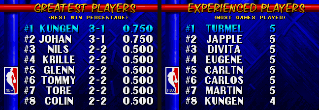
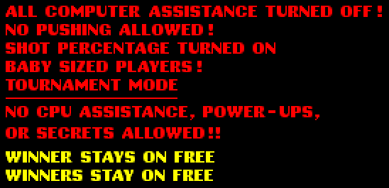
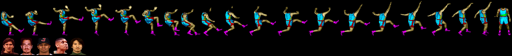

# NBA Hangtime and Maximum Hangtime

Midway's 1996 follow-up runs on the Wolf unit (TMS34010, like NBA Jam). Versions looked at here: the arcade NBA Hangtime
(L1.3 10/10/96, the MAME parent `nbahangt`, plus L1.1, L1.2 and M1.1-M1.3), arcade Maximum Hangtime (`nbamht` L1.03,
`nbamhtl10`, `nbamhtm10` and the L0.9 prototype `nbamhtp`), and the home versions on N64, PlayStation, Super
Nintendo and Genesis. The PC disc packs its game into an InstallShield `DATA.Z` that wasn't unpacked, so the PC
version isn't covered.

Arcade addresses are TMS34010 bit addresses (as MAME shows them); the program ROM is `u54`/`u63` interleaved and
mapped at `FF800000h`, so file offset = (address - `FF800000h`) / 8.

## Arcade: secret players

There are no initials and birthdays here: you create a player with a six-letter name and a four-digit PIN. The check
(`FFAB8C70h`) compares the entry's ten 16-bit words with a table at `FFAB9200h` (61 entries of 20 bytes, all
revisions of NBA Hangtime). A letter is stored as A = 1 ... Z = 26, a typed space as 29, and letters after END as 0; a
PIN digit is stored as digit + 1, and the PIN grid's SPC key as 11. All ten words must match exactly.

| Name | PIN | In game | | Name | PIN | In game |
|------|-----|---------|-|------|-----|---------|
| `JAPPLE` | 6660 | Japple | | `JASON` | 0729 | Air Morris (another head) |
| `DIVITA` | 0201 | Divita | | `QUIN` | 0330 | Quinn |
| `TURMEL` | 0322 | Turmell | | `PERRY` | 3500 | Perry |
| `DANIEL` | 0604 | Thompson | | `NFUNK` | 0101 | Funk |
| `EUGENE` | 6767 | Geer | | `MDOC` | 2 0 ? ? | M-Doc (can't be entered) |
| `JC` | 0000 | Carlton | | `NOBUD` | 1010 | Funk (another head) |
| `JFER` | 0503 | Hedrick | | `MARIUS` | 1005 | Muresan (an old man) |
| `JONHEY` | 6000 | Hey | | `MUNDAY` | 5432 | Munday |
| `MORRIS` | 6000 | Air Morris | | `NORTH` | 5050 | North |
| `BARDO` | 6000 | Bardo | | `AMRICH` | 2020 | Amrich |
| `MINIFE` | 6000 | Minifee | | `JIGGET` | 1010 | Jiggetts |
| `MARTY` | 1010 | Martinez | | `PIPPEN` | 0000 | Pippen |
| `CARLOS` | 1010 | Pesina | | `RODMAN` | 0000 | Rodman |
| `SHAWN` | 0123 | Liptak | | `JOHNSN` | 0000 | Johnson |
| `EDDIE` | 6213 | Ferrier | | `RICE` | 0000 | Rice |
| `MXV` | 1014 | Vinikour | | `KIDD` | 0000 | Kidd |
| `JAMIE` | 1000 | Rivett | | `MOTUMB` | 0000 | Mutombo |
| `NICK` | 7000 | Ehrlich | | `GHILL` | 0000 | Hill |
| `ROOT` | 6000 | Root | | `DREAM` | 0000 | Olajuwon |
| `MEDNIK` | 6000 | Mednick | | `MILLER` | 0000 | Miller |
| `DANR` | 0000 | Roan | | `SMITS` | 0000 | Smits |
| `PATF` | 2000 | Fitzgerald | | `MOURNG` | 0000 | Mourning |
| `KOMBAT` | 0004 | Boon | | `GLENNR` | 0000 | Robinson |
| `MORTAL` | 0004 | Tobias | | `WEBB` | 0000 | Webb |
| `SNO` | 0103 | Oursler | | `EWING`, `STARKS`, `AHRDWY`, `HGRANT`, `STACKH`, `CLIFFR`, `DAVIDR`, `ELLIOT`, `KEMP`, `MALONE`, `WEBBER`, `MURSAN` | 0000 | |

"In game" is the name the scoreboard shows at tip-off. All 61 were checked in MAME by writing each entry's ten words
into the player's entry at the moment the check reads the table, then going on to team select (portrait) and
tip-off (name); `TURMEL`/0322 and `JC`/END/0000 were also typed on the grids.

**M-DOC can't be entered.** Its PIN words are 3, 1, 0, 0. Typed digits are 1-10 and SPC is 11, DEL only deletes, and
letting the PIN timer run out goes on to team select without a match, so the last two words can never be 0. Maximum
Hangtime stores it as 2000 and it works there (typed in MAME).

Next to the table there's a second list, of nine default saved records (`TURMEL0000` ... `MARTIN0000` at
`FFA627E0h`) that a new CMOS starts with, and the program still carries NBA Jam's hidden copyright message, every letter
doubled ("NNBBAA  JJAAMM  --  CCOOPPYYRRIIGGHHTT  11999933 ...", file offset `0x5CB54`).

## Arcade: Tonight's Match-Up codes

The screen shows three digits, the presses of Turbo, Shoot and Pass. Each player's are packed into one word
(`@1141840h` + 0x10 per player, Turbo in the hundreds nibble); holding the joystick while pressing counts a digit down
instead of up, and digits wrap from 9 to 0 (`FFB60BB0h`). When the screen ends, `FFB62A40h` compares each word with a
13-entry table at `FFB624C0h` and sets that player's bit in the code's flag word (`@1136C20h` + 0x10 per code):

| Code | Effect | Flag |
|------|--------|------|
| 1-1-1 | Tournament mode (all human players must enter it) | `@1136C20h` |
| 0-2-5 | Baby-sized players | `@1136C30h` |
| 0-4-8 | No music | `@1136C40h` |
| 9-3-7 | No goaltending | `@1136C50h` |
| 6-1-6 | **Nothing** | `@1136C60h` |
| 7-0-9 | Quick hands | `@1136C70h` |
| 8-0-2 | Max power | `@1136C80h` |
| 2-8-4 | Max speed | `@1136C90h` |
| 5-5-2 | Hyper speed | `@1136CA0h` |
| 2-7-3 | Stealth turbo | `@1136CB0h` |
| 4-6-1 | Unlimited turbo | `@1136CC0h` |
| 3-9-0 | No pushing | `@1136CD0h` |
| 1-2-0 | Fast passing | `@1136CE0h` |

Checked in MAME: each code (entered on player 1's buttons) sets its flag, and tip-off shows its caption ("BABY SIZED
PLAYERS!", "GOAL TENDING", "QUICK HANDS", "MAX. POWER", "MAX. SPEED", "HYPER SPEED", "STEALTH TURBO", "UNLIM.
TURBO", "NO PUSHING", "FAST PASSING"). 0-4-8 has no caption: its flag is only read where the game picks music.
Recorded with MAME's `-wavwrite` against a run without it, the first 40 seconds of play fall from a steady level of
about 35-60 (RMS, 3-second windows) to about 11-35, with only short peaks left: the music is off and the effects and
commentary stay. 1-1-1 is turned down with a sound in a one-player game, as the in-game tip says ("all
players must enter the same combination").

**6-1-6 does nothing.** It's published as max shot blocking, and the game accepts it and sets `@1136C60h`, but
that word is only ever cleared (`FF8DA760h`) and never read.

## Arcade: match-up joystick codes

A second set of codes is watched by ten small processes started per human player (list at `FF8CC130h`, started by
`FF8CBB80h` a little after the match-up screen appears). Each looks at that player's whole input state on every frame
it changes (bits: Up 1, Down 2, Left 4, Right 8, Shoot `$10`, Pass `$20`, Turbo `$40`), so "hold Right, press Pass"
is the state `$28`. Most have about a second (60 frames) from their first input; the four-at-once code has 80.

| Code | Inputs | Flag | Seen in play |
|------|--------|------|--------------|
| Big heads | Up + Pass + Turbo together | `@1136B90h` | "BIG HEAD" |
| Huge heads | Up, Up, Pass, Turbo | `@1136BA0h` | bigger heads, "BIG HEAD" |
| Shot percentage | a full clockwise turn from Up | `@1136BB0h` | "SHOT % ON" |
| No tag arrows | Left, Left, Pass, Turbo | `@1136BC0h` | "NO ARROWS" |
| No drift | Down, Down, Shoot, Turbo | `@1136BD0h` | (no caption) |
| No CPU assistance | hold Right, Pass, Pass | `@1136BE0h` | (no caption) |
| ABA ball | hold Right, Shoot, Turbo, Pass | `@1136BF0h` | red, white and blue ball |
| Rooftop court | hold Left, Turbo, Turbo | `@1136C00h` | night rooftop court |
| Four at once | Shoot, Shoot, then hold Shoot through a clockwise turn from Up | sets the four above | big heads, shot %, ABA ball, rooftop |
| Lock | any Down press | `@1136B80h` | that player's digits stop and flash |

All entered on player 1's controls in MAME (each about two seconds into the screen), checked by their flags and in
play. The Down lock explains why some published codes end in Down; [Dan Amrich's list](https://www.bunnyears.net/hangtime/hangtimecodes.html)
mentions it. The four-at-once code is on no list we found; the published "2-0-0 + Left" outdoor court is really the rooftop code (hold Left, Turbo, Turbo), since
Turbo presses also count up the first digit.

All NBA Hangtime revisions (L1.1, L1.2, L1.3, M1.1, M1.2, M1.3) have the same two tables. The M revisions keep
195 saved player records instead of 410 (see [variants.md](variants.md#arcade-revisions)).

### Which flags the game reads

A MAME read/write tap over `@1136A00h`-`@1136EFFh` through a whole game (and a scan of the program for every
`MOVE` to or from the block) accounts for every word. Each joystick and match-up flag has a setter and a reader, with
two exceptions:

- `@1136C60h` (6-1-6) is read only by the match-up check that sets it.
- `@1136C10h` is the **hot spots** flag. NBA Hangtime already has the "HOTSPOTS ON" caption (the caption routine at
  `FF9EBEE0h` reads the word), but nothing sets it: the only writes are the clears at `FF89F4F0h` and `FF8DA910h`, and
  no gameplay code reads it. Forced on at the match-up in MAME, the caption shows at tip-off and nothing else happens.
  Maximum Hangtime adds the code and the hot spots themselves.

### The rooftop court outside the code

- **Every 100th attract-mode demo is played on the rooftop.** `FFA0A830h` counts demos in `@1138D00h`; when the count
  reaches 100 it starts over and sets the rooftop and ABA-ball flags (`@1136C00h`, `@1136BF0h`) for that one demo.
  Checked in MAME by setting the count to 99: the next demo was a night rooftop game.
- **Holding Up + Right at the start of a rooftop game plays a "boing" used nowhere else.** At the start of every rooftop
  game, `FF8C0BE0h` reads each player's input word (`@11322A0h` + 16 × player). If any player is holding exactly Up +
  Right (`9`), it plays sound script `FF9F85A0h` (DCS command `$0BA2`, used nowhere else in the program) instead of
  calling `FF8A7D80h`. Checked in MAME: with Up + Right held through the tip-off of a rooftop game, `$0BA2` goes to the
  sound board, and without it, it doesn't; the screen is the same either way. The sound is a cartoon "boing"; a
  recording is on the codes page.
- **Maximum Hangtime** keeps the Up + Right check (`FF8B9190h`, same sound script; checked in MAME on L1.03, with
  `$0BA2` sent only when Up + Right is held), started when its court flag `@1136C60h` is set; the match-up court selector sets that flag (Right) and clears it (Left). It drops the
  every-100th demo. Instead `FFA0DA20h` steps a counter (`@1138DA0h`) through a 7-entry table (`FFA0E8F0h`: 1, 3, 1,
  0, 3, 1, 2) and sets `@1136C60h` from bit 0 and `@1136C50h` from bit 1. `@1136C60h` picks the outdoor court (one of
  several, chosen at random at `FF8AE3B0h`); `@1136C50h` is Maximum Hangtime's ABA-ball flag, read only where the ball
  and its images are set up (`FF901A00h`, `FF91BA40h`), and also set by the ABA code (hold Right, Shoot, Turbo,
  Pass; `FF8C7220h` checks the last step). Checked in MAME by forcing each flag alone through a game: `@1136C60h` gives the outdoor court,
  `@1136C50h` changes only the ball to red, white and blue, with the same sound commands; a demo with only
  `@1136C50h` set was in the stadium.

## Arcade: the trivia contest

NBA Hangtime carries a 1996 sweepstakes, "NBA HANGTIME TRIVIA GAME" (rules in the program at `FFA2E0C0h`, prizes: a trip
for two to an NBA game, an NBA Hangtime cabinet, 25 jerseys, 1,000 T-shirts; entries closed September 13, 1996). It's
an operator setting, TRIVIA CONTEST (adjustment `20h`, on from the factory). Attract mode shows the prize screen and the
"TRIVIA MASTERS" record table.

At game over (`FFA217A0h`), a player gets questions only after a full game (`@1137A30h` = 4, i.e. all four quarters)
and only while their trivia points (`@11397D0h` for player 1) are under 100 (`FFB7BAB0h`). Each question is multiple
choice, worth 2 points. At 100 points the game shows "CONTEST DRAWING QUALIFIER", then "CONGRATUATIONS !!!" (sic) and an
8-letter password to mail to a Phoenix P.O. box with your name and PIN. Checked in MAME by forcing the quarter counter
to 4 and the points to 98, then answering "What is the name of the NBA franchise in Miami?" with Heat: AAAAAA 0000 got
`EOFTCSJN`. A one-quarter game (two credits) never reaches the questions.

## Maximum Hangtime

Same name check and the same 13 match-up numbers. The joystick codes are rewritten (`FF8C4930h` on): the court becomes
a "COURT: STADIUM / OUTDOOR" selector on the match-up screen (Right picks the rooftop court, Left goes back; published
as "press Left", which leaves it on Stadium), and hot spots are added (Up, then Up + Shoot, twice: "HOTSPOTS ON").
Outdoor court, hot spots and big heads were checked in MAME. The flag words move: big heads is `@1136BF0h`, the ABA
ball `@1136C50h` (still hold Right, Shoot, Turbo, Pass; checked in MAME) and the outdoor court `@1136C60h`. The
operator setting PLAYER HEAD SIZE (adjustment `1Ah`, "LARGE SIZE: 2") is applied at game start by flipping every
player's big-head bit (`FF8D44B0h`, read from the code), so on a large-head cabinet the big-head code gives normal
heads. The name table (`FFAAF360h`) grows to 86 entries: `WEBB` is dropped (Spud
Webb becomes `SPUD`), `MDOC` is fixed to 2000, `JASON`'s PIN becomes 0, 7, 2, SPC, and 25 are added:

| Name | PIN | In game |
|------|-----|---------|
| `ZIRIN` | 1010 | Zirin |
| `HEITH` | 1079 | Bettleman |
| `MATT B` | 0184 | Bettleman (a second, younger head) |
| `K DAY` | 4242 | a cartoon basketball mascot ("FUNK" on the scoreboard) |
| `MCLOUD`, `TMILLS`, `KSMITH`, `MCKEE`, `CHAPMN`, `BENJMN`, `DOUGLS`, `SPUD`, `GILIAM`, `KEVINE`, `OAKLEY`, `RUFFIN`, `WESLEY`, `FINLEY`, `BUCK`, `PERSON`, `ALVINR`, `OMILLR`, `MURRAY`, `BENOIT`, `BSCOTT`, `MURDCK` | 0000 | NBA players |

`MDOC`, `JASON`, `ZIRIN`, `HEITH`, `MATT B`, `K DAY` and `TURMEL` were typed in MAME (L1.03); all 86 were also checked
by writing them into the check. The prototype and the other two revisions have the same table.

The same read/write tap on Maximum Hangtime (and a full disassembly) finds no leftover flag like NBA Hangtime's hot
spots: every joystick and match-up word has a setter and a gameplay reader except 6-1-6 (`@1136CC0h` here), which is
again read only by its own check, so it does nothing in Maximum Hangtime either.

## N64 and PlayStation

Both keep the arcade table, packed as bytes (N64 ROM `0xA0440`; PlayStation in `PRES.BIN` inside `BIGLUMP.BIN`, file
offset `0x16C8C`), with some entries blanked out by giving them an impossible name (bytes `$21`-`$26`) or an
ASCII "0000" PIN:

- **N64:** `NOBUD`, `MARIUS`, `NORTH` and `JIGGET` blanked; `MDOC` still 2, 0, 0, 0 stored as 3, 1, 0, 0, so still
  unreachable. The European cartridge's table (`0x9F600`) differs in only those two bytes: it stores 3, 1, 1, 1, so
  `MDOC` 2000 works there.
- **PlayStation:** `NOBUD`, `MUNDAY`, `NORTH` and `JIGGET` blanked; `MARIUS` renamed `OLDBOY` 0505; `MDOC` fixed to
  2000.

Both also keep the arcade's 13 match-up numbers (N64 `0xA0148`, PlayStation `PRES.BIN` `0x13598`). All 13 were entered
in BizHawk on each. Every number sets its own flag (N64: halfwords at RDRAM `0xA6EC6` + 2 per code, set by `0x80048F70`;
PlayStation: words around `0x73300`-`0x735F4`). Ten show the arcade's tip-off caption (baby-sized players, goaltending,
quick hands, max power, max speed, hyper speed, stealth turbo, unlimited turbo, no pushing, fast passing).
Tournament mode is refused in a one-player game, as on the arcade, and on N64 nothing reads 6-1-6's flag
(`0x800A6ECE`), so it does nothing there too.
`OLDBOY` 0505 was typed on the PlayStation in BizHawk: the old bearded head from the arcade's `MARIUS`, with hidden
attributes.

Both also keep the arcade's joystick detectors, entered in BizHawk at the match-up and found by RAM diffs:

- **N64:** A is Turbo, C-Down Shoot, C-Right Pass. The flags are 16-bit words at RDRAM `0xA6EB2` in the arcade's order
  (lock, big heads, huge heads, shot %, no arrows, no drift, no assistance, ABA ball, rooftop). All ten codes, the
  four-at-once code included, set their flags. The turns work on the D-pad as well as the control stick: a second run
  watching these flags got the same shot % flag, and big heads, shot %, ABA ball and rooftop for four at once, from
  either.
- **PlayStation:** Square (or any shoulder button) is Turbo, X or Triangle Shoot, Circle Pass. Big heads (`0x7320C`),
  huge heads (`0x73314`), shot % (`0x7322C`, D-pad turn), no arrows (`0x735A4`), no drift (`0x732B8`), no assistance
  (`0x732D4`), ABA ball (`0x732EC`), rooftop (`0x735DC`) and the Down lock (`0x734A0`): all ten checked. Four at once
  sets big heads, shot %, ABA ball and rooftop, but only when entered fast: at 5 frames a step (about 0.9 seconds for
  the whole code) it worked, at 6 frames a step nothing was set. Its two Shoot presses also count as match-up
  numbers, so entered alone it can leave 1, 2, 0 (fast passing); an extra Shoot press first avoids that.

Neither has Maximum Hangtime's hot spots code. At tip-off both print the arcade's captions for these codes ("BIG HEAD"
for big and huge heads, "SHOT % ON", "NO ARROWS"); the ABA ball has no caption but shows its colours in the air.

All 63 files in the PlayStation `BIGLUMP.BIN` are named in the program, so none is orphaned. The disc also carries
`HANGTIME.MAP`, the mastering tool's log (BuildCD 2.39.b, 27 April 1997, paths under `D:\HANGTIME\VERSION\PSX\RELEASE\CD`).
It lists an earlier layout that has no `SLUS_003.29` and puts the files at other sectors.

## Super Nintendo and Genesis

Funcom's 16-bit ports have no secret players. The names published for them are preset saved records:

- **Super Nintendo** (file offset `0xB516`): `CHE` 6581, `KUNGEN` 1414, `HENRIK` 6502, `JOHAN` 1911, `OLAV` 2509,
  `CHRIS` 0912, `NILS` 5555, `TORE` 1505, `TURMEL` 0000, `DIVITA` 0000, mostly Funcom staff (the credits list
  Henrik Holmdahl, Che Lalic, Olav Mørkrid, Tore Blystad, Johan Andersson, Nils Erik Hatlem). `KUNGEN` 1414 typed in
  BizHawk opens a 2-3 record with a custom character; all ten were typed for the codes-page screenshots and each opens
  its record.
- **Genesis** (`$37832`, copied to the cartridge save at `$303220`): `KUNGEN` 7209, `JOHAN` 1911, `CENSOR` 1700,
  `ENRICO` 0666. `KUNGEN`, `CENSOR` and `ENRICO` typed in BizHawk each bring up their "TOP 5 DEFENSIVE PLAYER" record.
  `JOHAN` needs a space typed after it: ending the name with the end key gives NO RECORD, with the space it opens a
  3-1 record.
  The save is marked valid by the signature "NITEMARE" (`$300004` and `$3033C4`).

Their match-up numbers:

- **Super Nintendo** (presses of Y, B, A; table at file offset `0x57771`): the arcade's numbers except 0-2-5 and
  0-4-8, so 11 codes, all entered in Mesen 2 and checked by their flags (`$7E58`, `$7E5E`-`$7E70`). **A bug:** the
  lookup (`$C576C5`) compares a player's numbers with each entry before checking for the 0-0-0 end marker, so a player
  who enters nothing matches the end marker and takes the next two bytes of code (`$C208`) as a power-up mask: bits
  for goaltending and stealth turbo. With no code entered, those two flags are set (checked in Mesen 2).
- **Genesis** (presses of A, B, C at `$FF4B7A`-`$FF4B7C`, checked after every press against `$12A2E`): 12 codes, no
  0-2-5, and fast passing is 1-2-7 instead of 1-2-0, as published. All 12 entered in BizHawk and checked by their
  flags (`$FF11A0` + 2 per code); tournament mode works in a one-player game, and entering nothing sets nothing.
- Neither 16-bit version prints a caption for a number code (9-3-7 checked at tip-off on both, flag set). The codes
  page's screenshots for them show the match-up screen with the numbers entered. The codes must be entered quickly:
  presses spaced more than a few frames apart run past the end of the screen.

### Super Nintendo joystick codes

Nine sequences, listed at `$C5B3B0` (pointer, bank) and checked every frame of the 360-frame match-up loop
(`$C574AB`) by `$C5B31B`. Each step is compared with the whole pad word (`$1602` + 2 per player). A step that doesn't
match is skipped rather than resetting the code, so extra presses in between don't matter, but held buttons do: "hold
Left, Y" means the pad reads exactly Left + Y. A finished code sets its bit in `$B9CE` + 2 per player, and the match-up
then applies them (`$C5779F`):

| Bit | Inputs | Sets | Published |
|-----|--------|------|-----------|
| 0 | Left, Left, B, R | `$7E4C` (no tag arrows) | yes |
| 1 | L, R, Select, Start, Up, Down, A, B, Y, X | `$16AE` = 3 (jungle court) | yes |
| 2 | hold Right, B, B | `$7E50` (no CPU assistance) | yes |
| 3 | hold Right, R, Y, B | `$7E52` | **no** |
| 4 | B, B, then hold B through a counter-clockwise turn from Up | `$7E52`, `$7E4E`, `$16AE` = 1 | **no** |
| 5 | hold Left, Y, Y | `$16AE` = 1 (rooftop court) | yes |
| 6 | Up, Right, Down, Left, Start, A, B, Y, X, Select | nine cheats | yes, as four |
| 7 | hold Down, B, A, X, Y, then let go of Y | `$16AE` = 2 (city court) | yes, without the last step |
| 8 | Start, Y, Right, A, B, Up, Start, Up, Down, Down, Start, L, A, Down, Down | all eight bits | yes (cheat ending) |

- `$7E52` starts a task at tip-off that flashes the ball white three times in the referee's hands (screenshots
  compared frame by frame in BizHawk); nothing else differed. Bit 3 has the shape of the arcade's ABA ball code.
- `$7E4E` is a per-player bit that zeroes four of the player's movement values (`$C47E9E`), like the arcade's no drift.
  Bit 4 is the 16-bit version of the arcade's four-at-once code, turning the other way.
- Bit 6 sets the flags of nine number codes: goaltending, max block, max steal, max power, max speed, hyper speed,
  stealth turbo, unlimited turbo and fast passing.
- After the match-up the game ORs every player's bits together and plays the cheat ending (`JML $C800E9`) if all eight
  are set (`$C5753E`). The long code is one way to get there; the other eight codes, split across any players, are another.
  All eight entered on one pad in a single match-up (three frames per step) in Mesen 2 reached `$C800E9`.
- Bits 1 and 6 press A, B and Y once each, which also leaves the numbers on 1-1-1, tournament mode. Tournament mode
  clears the number-code flags (`$C311C5`) before the joystick bits are applied, so it cancels number codes typed earlier
  but not these.

All nine were entered in Mesen 2 and checked by `$B9CE` and the flags above; the cheat ending code reached
`$C800E9`. The window is short: the loop runs 360 frames, starting about two and a half seconds after Start.

### Genesis joystick codes

Six detectors, listed at `$12B10`, each a chain of states that waits for a pad state and then for the buttons to be
let go. In pad bits, A is Turbo, B is Shoot and C is Pass:

| Inputs | Sets | Notes |
|--------|------|-------|
| hold Left, B, B | `$FF297D` | rooftop (street) court, published as "outdoor court" |
| B, A, Right, Right, A, C, Up, Down, A | `$FF297D` and `$FF297F` | Hawaii court |
| Left, Left, C, A | `$FF1194` | no tag arrows: **never read**, the arrows still show |
| Down, Down, B, A | `$FF1196` | no drift (read at `$25DAA`) |
| hold Right, C, C | `$FF1198` | no CPU assistance (read at `$25836`) |
| hold Right, A, B, C | `$FF119A` | ABA ball, published as "A, B six times, and C" |

All six entered in BizHawk and checked by their flags; both courts and the ABA ball were seen in play. The published
Genesis big heads, huge heads, shot percentage and "hold Left, A three times" rooftop codes have no detector. Only two
courts exist (the ROM's feature list says "ROOFTOP COURT", "HAWAII COURT").

Tournament mode (1-1-1, `$FF11A0`) makes the tip-off code (`$1C1A8`) clear every joystick flag. The numbers are checked
after every press, so a code's A, B and C presses (or presses after it) can pass through 1-1-1 and cancel it: our first
no-arrows test did exactly that.

### Genesis options screen

The options screen (`$B91C`; Right on the main menu, then A) starts three more sequence checkers (`$BB6C`, comparing
each new press with a list):

| Inputs | Effect |
|--------|--------|
| C, A, Right, Left, Right, Up, Left, A, Right | plays the credits roll ("FUNCOM HOME VERSION", "MIDWAY COIN OP VERSION", "ORIGINAL MUSIC", "ACTORS", ...), the same one attract mode picks half the time after its demo game (`$ABA0`) |
| B, A, Right, Right, A, C, Up, Down, A | sets `$FF297F`, the Hawaii half of the court setting, which is only read when the court flag `$FF297D` is set; the match-up court codes set or clear it anyway, so it does nothing |
| A, B, A, C, Up, Start | sets `$FF0C52`, which nothing reads (checked in code and with a read watch through attract mode). The Start also leaves the screen |

All three entered in BizHawk.

### Other Genesis leftovers

- Thirteen built-in player records at `$36374` (MARTIN, CARLOS, CARLTN, EUGENE, DIVITA, JAPPLE, TURMEL, then Funcom's
  NILS, KRILLE, GLENN, TOMMY, TORE, COLIN, all PIN 0000). A published list calls them "scrapped secret
  players", but they're the default record holders: attract mode shows them on its record screens (Greatest Players:
  KUNGEN, JOHAN, NILS, KRILLE, GLENN, TOMMY, TORE, COLIN; Experienced Players: TURMEL, JAPPLE, DIVITA, EUGENE, CARLTN,
  CARLOS, MARTIN, KUNGEN), and `$3664A` walks them before the saved records when it builds those tables. The record
  lookup at name entry doesn't use them, and typing TURMEL 0000 changed nothing.

  
- "SVEN-BERTIL", "EVERT", "KROKODILEN" and "CARL-HENRIK" sit after "PRESS  START" at `$5A30` with nothing pointing at them.
- "MIDWAY sucks!" sits between two routines at `$CE12` in both carts. No absolute pointer or PC-relative `LEA`/`PEA`
  reaches it.

### Music

Neither cart has unused music in its own sound driver. The Super Nintendo cart also carries a second driver with a
song of its own, packed away as a separate program (below).

- **Genesis.** The sound driver is GEMS (banks set up from `$A34`: patches `$AC81C`, envelopes `$ACF27`, sequences
  `$55040`, samples `$56F09`), with 131 sequences. The songs are 30-35 (4 to 7 tracks); the rest are one-track sounds
  or empty. A MAME run of attract mode and a random-input game started 30, 31, 32 and 34, and 33 and 35 are started
  by `$37DDE` and `$19D44`.
- **Super Nintendo.** The music comes in two sets, each loaded by `$C5B49C` from its tables at `$C5B559`, and the game
  loads both (with 0 and with 1).

### Super Nintendo: the packed sound test

The RNC block at file offset `0x2192A2` (`$E192A2`) is a whole program. Every other block is unpacked by `$C2FDAB`,
whose callers load the address as two immediates (`LDX #low`, `LDA #bank`) or from a table. This one has no caller, and
no pointer in any form. It unpacks to 32 KB: a LoROM image with its reset vector at `$8000`. The packed copy has one
stray byte in front (`$18`) and is missing the `E` from its hex-digit table, so the code before that table is one
byte off.

The program sets up its own sound chip code: it waits for the IPL handshake and uploads `$559F` bytes from `$7E:8282` to
`$0400` in the sound chip. Those bytes aren't SLICK/Audio, the game's driver at `$C5:C5DA`, and the two share
almost nothing. The rest is a test screen: it prints the APU ports `$2140`-`$2142` as six hex digits and turns the
bits of `$2143` into eight channel meters. It never loads a font, so the screen stays blank. Rebuilt as its own
cartridge in BizHawk, it plays a song. A published list credits a second driver and song in this cart to Alfatech,
and this is the only other sound chip code in the ROM.

`tools/htsnes_soundtest.py` makes a playable `.sfc` from the US or European cart. It fixes the two bytes, points the
upload at the ROM copy of the data, and lets the reset entry run on into the test loop.

### European versions

The European Super Nintendo and Genesis cartridges have the same name tables, match-up numbers, joystick sequences,
options-screen sequences and preset records as the US ones, only moved (Super Nintendo number table `0x577C2`, sequences
`0x5B429`; Genesis numbers `$12A34`, presets `$37838`). The European N64 differs from the US in its `MDOC` PIN (above).

## The logo

The arcade only draws its logo as part of the full-screen title picture (ten 8-bit tiles of one composited image,
`05C8D817h` ... `05D40857h` in the image ROMs), and the N64 and PlayStation title screens are the same flattened
picture. The Genesis title puts the logo on its own planes (A and the window) over the background on plane B, so
`tools/img/logo_hangtime.png` is the Genesis logo, cut by taking the frame with plane B switched off and keeping the
pixels that don't change when it's switched back on.

## Checked against published lists

Claims from published lists, checked here:

- **Arcade: Secret Midway Menu.** Hold P1 and P2 Up and all buttons through the start-up screens, switch to Down for the
  DESIGN TEAM screen, then P1 Turbo ×2, P2 Shoot ×3, P2 Pass ×2, P1 Shoot, P1 Pass, P2 Turbo ×2, P1 Turbo ×4.
  Entered in MAME on L1.3: "SECRET MIDWAY MENU, NBA HANGTIME – VER L1.3 10/10/96".
- **Arcade: NBA Jam's hidden credits** are still in the program at `FFAE5482h` ("NBA JAM - COPYRIGHT 1993 MIDWAY
  MANUFACTURING COMPANY", the designers), stored with each character doubled.
- **Genesis: the 13 names at `$3637C`** aren't cut secret players (see [Other Genesis leftovers](#other-genesis-leftovers)):
  they're the default record holders in the attract-mode tables.
- **Super Nintendo: FUNCOM / 1993.** The game answers NO RECORD (no saved record by that name), and the next button
  press shows a photo of the Funcom team with captions naming each person. Checked in BizHawk. The name isn't stored
  as text anywhere in the ROM, so the check is in code.
- **Super Nintendo: the full ending.** All eight joystick codes give a short version ("YOU REALLY SHOULD HAVE DEFEATED
  ALL 29 NBA TEAMS TO SEE THIS!" then "DEFEAT ALL 29 NBA TEAMS FOR A FULL VERSION!"). The full version (forced in
  BizHawk by changing the ending's flag) runs "CONGRATULATIONS!!", the Funcom credits with anagrams of each name
  ("OLAV MOERKRID: MILK OVER ROAD", "NILS ERIK HATLEM: THIS LAME LINKER"), "THIS SCREEN MADE BY OLAV & TORE" and "THANK
  YOU FOR PLAYING NBA HANGTIME!".
- **Genesis: SVEN-BERTIL, EVERT, KROKODILEN, CARL-HENRIK** at `$5A30`: confirmed unused.
- **Super Nintendo: the "Fourth Dimension" music.** A published list asks whether anything plays it. Nothing in the game does: the only
  unpacked code in the ROM that writes to the sound chip's ports is the SLICK/Audio uploader (`$C5:C080`, run once at boot with the
  driver at `$C5:C5DA`) and a second, uncalled copy of an upload loop (`$C5:B7FD`/`$C5:B810`) that sends the same SLICK
  driver. Pointing the boot upload at that second copy in BizHawk gave silence, as a driver waiting for commands would.
  The second driver and its song are in an RNC block that nothing points at (see
  [Super Nintendo: the packed sound test](#super-nintendo-the-packed-sound-test)), so the game itself can't play it.
- **N64: the "unused" credits play.** A published list says there's no way to show them. Attract mode (`0x80044120`) counts its
  loops in `0x800A76BC` and calls the credits routine (`0x80044AC8`, the only code that loads those strings) whenever
  the count is 2 mod 4: the third loop, about 8 minutes after power-on, and every fourth after that. Checked in BizHawk
  (with the counter set to 1 to save a loop): Programming: Jamie Rivett, Gary Liddon, Graeme Webb; Graphics: Terry Ford;
  Music: Rob Atesalp; then the testers, producers and the arcade credits.
- **Build dates** (all present): Super Nintendo "September 24 1996 11:37" and henrik@funcom.com (`0xC971`); N64 US
  "Oct 29 1996 10:25:52" (`0xA3650`) and EU "Jun 3 1997 16:22:11" (`0x97256`), with the memory-manager error text
  (`0xA34B0`); PlayStation "Apr 27 1997" in `SLUS_003.29` (`0x4E1D3`).

## Arcade: unused graphics

`tools/arcade_gfx.py roms/nbahangt.zip` decodes the Wolf unit's images: the same 18-byte headers as NBA Jam, with the
20 graphics chips in 4 MB banks (read off MAME's assembled region and rebuilt from the chip files). L1.3 has 7,723
headers. The blitter takes the same command and offset values at `01A80010`-`01A80030`, with size and position at
`01A00040`-`01A00070`.

The team logos (`FFF56F70`-`FFF580E0`) are pointed to one each, except three: new logos for the **Pistons**
(`FFF573F0`), **Timberwolves** (`FFF57900`) and **Jazz** (`FFF57FC0`), the designs those teams took up for 1996-97.
Every NBA Hangtime revision (L1.1, L1.2, L1.3, M1.1, M1.2, M1.3) points to the old logos instead; every Maximum Hangtime
revision (the L0.9 prototype, L1.0, M1.0, L1.03) points to the new ones and not the old. The **DCS Sound System**
logo (`FFF58170`) at the end of the block is pointed to by no revision of either game, and wasn't drawn in 36,000
frames of attract mode from power-on.

  

Nine 9-to-15-pixel captions after `FFC44470` have no pointer in any of the ten revisions above, and nothing points to
their graphics offsets either:

- seven red ones with their own palette (`FFC757E0`, `FFC44620`-`FFC44980`): "ALL COMPUTER ASSISTANCE TURNED OFF!",
  "NO PUSHING ALLOWED!", "SHOT PERCENTAGE TURNED ON", "BABY SIZED PLAYERS!", "TOURNAMENT MODE" and "NO CPU
  ASSISTANCE, POWER-UPS, OR SECRETS ALLOWED!!";
- "WINNER STAYS ON FREE" twice (`FFC44500`, `FFC44590`), shorter forms of the yellow attract-mode notice "WINNERS STAY
  ON FREE IN 4 PLAYER GAME!" (`FFC44470`).

That notice is picked at `FFADA370` by operator setting 1Bh from a two-entry table at `FFADA800`: nothing, or
`FFC44470`. The match-up codes announce themselves with the purple badges loaded at `FF9EBEE0h`-`FF9ECA80h` ("NO
PUSHING", "SHOT % ON", "BABY MODE"). With 025, 390, 120 and 552 entered in MAME, a log of every blitter command showed
none of the nine drawn. Nor in tournament mode: in a two-player game with both players on 1-1-1 (flag word `6`), none
was drawn from the match-up screen through tip-off and into the first quarter. The red palette is still used, by the font text records at `FFABDB70`, `FFADA5A0` and
`FFB2BED0`.

  

**The rest of L1.3's unreferenced headers.** Of its 578 headers with no pointer, 107 are pointed to by some other
revision (mostly Maximum Hangtime's extra players' name labels and heads, and the 3 × 2 markers before each head set),
matched by graphics offset and size. That leaves 471 that no revision of either game points to, 258 of a usable size.
Not having a pointer doesn't prove an image unused, since code can reach one by adding to another's address. One of
the 258 is reached that way: a dark 88 × 5 strip (`FFC2A640`) whose graphics address shows up in every game log. None
of the other 257 was drawn in the attract-mode and random-game logs (18 runs), or from the match-up screen through
tip-off with each of the 13 match-up codes entered (MAME, a tap on the blitter's offset registers). What they are:

- **A player animation** (`FFD4D570`-`FFD4E9B0`): 19 headless frames of a player in a turquoise kit, a high kick, then
  a run-up and a leap; plus a standing frame in the same palette (`FFF89920`, `FFDC5220`).
- **Five portrait photos** (`FFC11840`, `FFC173F0`, `FFC175A0`, `FFC18A70`, `FFF8BF70`), the size of the secret
  characters' pictures.
- **Ten team-select name labels** (`FFF58560`-`FFF58F80`): MARCIULIONIS, ANZALONE, BENSON, BUTATA, HAEGER, KELLER,
  LAWMAN, LEE, MIKE and SEAN. None is on either game's roster.
- **Badges:** "BIG BALL" (`FFC301F0`) and "BABY MODE" (`FFC30430`) in the purple tip-off style, and "AUTO REBOUND"
  (`FFC2EDB0`) and "BREAK BACKBOARD" (`FFC2EED0`). With 0-2-5 entered, tip-off shows a purple "BABY SIZED PLAYERS!"
  banner, not the badge.
- 28 head frames in partial sets (`FFBE63F0`-`FFDC3FF0`), the other colours of the trivia contest's boxes
  ("TOURNAMENT MODE DISABLED", "CORRECT ANSWER", "INCORRECT ANSWER", "INVALID NAME ENTERED", "CONTEST DRAWING
  QUALIFIER"; the code points to one colour each), older copies of labels the game draws from other headers ("PRESS
  START", "INSERT COIN", "OVERTIME", "CHALLENGE ACCEPTED"), team-colour bars and ovals, arrows and 58 images under
  200 pixels.

  

## Not covered

- The rest of the arcade's unreferenced images. A log of every blitter offset over 36,000 frames of attract mode and
  18 runs of random-input play (16 of them four-player, 8 of those stepping each player to a random team at team
  select) drew 3,693 of the 7,145 pointed-to images, still too few to call anything unused: the last runs each added
  about 35. Two directed runs added 80 more: one played a game as each of the 61 name-and-PIN entries, the other
  picked each of the 29 teams in turn. Four more 170,000-frame four-player runs added another 155. Grouped by the
  pointer tables that hold them (before those last four runs), 3,206 of the images not yet drawn sit in tables where
  other entries were drawn (frames and team or player sets), and 271 sit only in the 108 tables none of whose entries
  was drawn. Decoded, those 270 or so are all things random play rarely reaches: rooftop scenery (skyline, moon, lamp
  posts, brick walls), the trivia contest and create-player screens, the match-up code captions, record badges
  ("WORLD RECORD HOLDER!", "TOP 10 PLAYER!"), fonts and the "VS" animation. None is new unused art. The unreferenced
  headers are sorted above; they could still be reached by address arithmetic in code no test ran.
- Arcade sound (DCS). The main CPU sends each command as two bytes to `@1680000h`, high then low, waiting for the
  board's acknowledge between them (`FF9F9920h`); `$55AA` followed by `$FF00` sets full volume. Sent one by one in
  MAME, 1,182 of the commands `$0000`-`$0FFF` make a sound. 776 of those appear in no fixed sound script in the
  program. Most fall in regular runs (`$04B3`-`$0757` in threes, for instance) that look like calls the game works out
  from a base number, such as player names, so which sounds are unused isn't settled.
- Arcade code coverage: those four runs ran 607 of the 1,198 call and jump targets (see
  [arcade.md](arcade.md#code-and-image-coverage)). Four more 120,000-frame runs in MAME kept a save state each time new
  code ran and restarted from those states with random input, which stays in the menus. They added 83, the
  create-player, record and name-notice screens, for 690 in all (58%). What still hasn't run is operator menus, tests,
  the credits, and the trivia and sweepstakes screens; nothing in either list is an unknown feature.
- Super Nintendo code coverage. Three 90,000-frame Mesen 2 runs with random input on a pad and a multitap ran 37,631
  of the 110,988 instructions the disassembler traces (33.9%). Much of the rest is the front end in bank `$C6`
  (menus, name entry, records), which plain random input doesn't get far into. Three more 300,000-frame runs kept a
  save state each time new code ran and restarted from those states with random taps, which keeps the input in the
  menus. That brought it to 41,411 (37.3%), with 91 of the 153 calls to the graphics unpacker run. Each run used its
  own renamed copy of the ROM, since Mesen otherwise starts from the coverage file it keeps for that ROM name. That
  file, the total from every Mesen session on this cart including the targeted ones on this page, has 145 of the 153
  calls run; the other eight are the multitap warning below (four), two team-table loads (`$C6A705`, `$C6A724`) and a
  branch at `$C7014F`. Large parts of bank `$C6` haven't run in any session (`$C673A2`-`$C6862A`,
  `$C695D9`-`$C6A40E`), so there's no list of unused routines yet. Two screens that need a particular console set-up
  never ran in the random runs:
  - On a PAL console (`$213F` bit 4) the US cart shows "This NTSC game pak is not designed for your Super NES/Super
    Famicom" (`$C30DF8`; seen in Mesen set to PAL).
  - With a multitap in port 1, Nintendo's connect check (`$C1C627`, marked "MODIFIED FROM SHVC MULTI5 CONNECT CHECK
    Ver1.00") sends the game to `$C30BEA`, a warning that the adapter must go in socket 2 (seen in Mesen).
- Super Nintendo graphics. The cart has 248 RNC-packed blocks. The unpacker (`$C2FDAB`) takes each block's address
  as two immediates or from a table, and every block but one has a caller. The random runs read 106 of them,
  and all Mesen sessions on this cart together 228. Of the other 20, 18 are in the 29-entry per-team tables
  (`$C0A08D`, `$C0A680`, `$C56619`, `$C5B75C`), for teams no session picked. One is the multitap warning's picture
  (`$E9FCB0`). The last is the packed sound test (above), which has no caller.

## Tests

- `tools/tests/hangtime_names.lua` (MAME): writes each table entry into the name check, shoots team select and the
  tip-off scoreboard.
- `tools/tests/hangtime_matchup.lua` (MAME): enters each match-up code and logs the 13 flag words.
- `tools/tests/genesis_hangtime_joystick.lua` (BizHawk): enters the six Genesis joystick codes and logs their flags at
  the match-up and in play.
