# Image index

Every picture in these notes, grouped by the page it appears on, with a link to the section that explains it.

## Arcade NBA Jam

| Picture | Where | What it shows |
|---|---|---|
|  | [arcade.md: Secret characters: nothing new](arcade.md#secret-characters-nothing-new) | The stats screen after entering MDP, January 13: rank 14, 8 wins and 12 losses |
|  | [arcade.md: The tank game's reward (rev 3)](arcade.md#the-tank-games-reward-rev-3) | Tip-off after the tank reward: shot % display, and big head, powerup intercept and powerup defense for all four players |
|  | [arcade.md: Hidden copyright message](arcade.md#hidden-copyright-message) | ALL PLAYERS POWERUP! at the end of the tank game |
|  | [arcade.md: Hidden copyright message](arcade.md#hidden-copyright-message) | The hidden copyright message over the tank game |
|  | [arcade.md: Hidden stats menu (rev 3.01)](arcade.md#hidden-stats-menu-rev-301) | All five pages of the hidden menu in rev 3.01: JAM INFO, audits, score stats, team counts and the records table |
|  | [arcade.md: Unused graphics](arcade.md#unused-graphics) | The NBA Jam Session logo, the front-on hoop, the trophy and the Chicago Bulls logo |
| 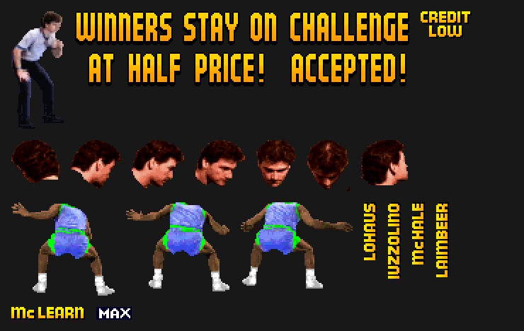 | [arcade.md: Unused graphics](arcade.md#unused-graphics) | Unused NBA Jam images: a crouching man in a white shirt, WINNERS STAY ON AT HALF PRICE!, CHALLENGE ACCEPTED!, CREDIT LOW, seven of the eleven head frames, three skipped player frames, four of the 57 vertical name labels, Mc LEARN and MAX |
| 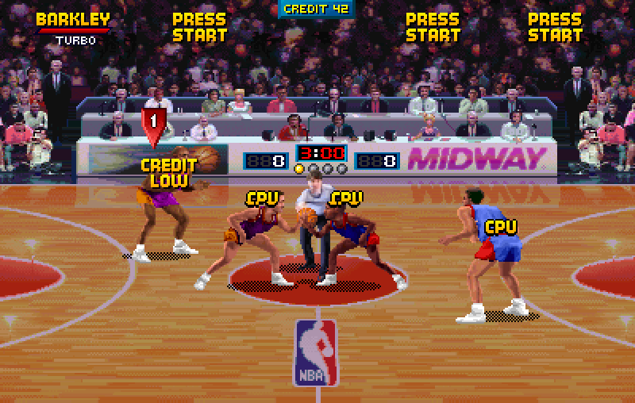 | [arcade.md: Unused graphics](arcade.md#unused-graphics) | CREDIT LOW over player 1's head at tip-off in the nbajamp1 prototype, forced in MAME |
| 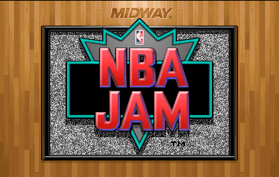 | [arcade.md: Title screen and attract mode](arcade.md#title-screen-and-attract-mode) | NBA Jam title screen |

## Arcade Tournament Edition

| Picture | Where | What it shows |
|---|---|---|
|  | [arcade_te.md: Not on the published lists](arcade_te.md#not-on-the-published-lists) | Rodman (ROD, rev 4.0 3/03), the Grim Reaper (BIG, rev 2.1) and Payton (GEE, Nani Edition) |
|  | [arcade_te.md: Backboard shatter (revs 1.00 to 2.1)](arcade_te.md#backboard-shatter-revs-100-to-21) | Rev 2.1: the backboard breaks on a dunk and the glass falls |
|  | [arcade_te.md: Backboard shatter (revs 1.00 to 2.1)](arcade_te.md#backboard-shatter-revs-100-to-21) | ALL COMPUTER ASSISTANCE TURNED OFF! at tip-off |
|  | [arcade_te.md: Secret Midway menu](arcade_te.md#secret-midway-menu) | All five pages of the Secret Midway Menu in rev 4.0: JAM INFO, audits, score stats, team counts and the records table |
|  | [arcade_te.md: Unused graphics](arcade_te.md#unused-graphics) | The O'NEAL and McKEY name labels |
|  | [arcade_te.md: Unused graphics](arcade_te.md#unused-graphics) | Unused Tournament Edition images: the crouching man, WINNERS STAY ON AT HALF PRICE!, CHALLENGE ACCEPTED!, CREDIT LOW, the head on its side, five arcs, O'NEAL, McKEY and MAX |
|  | [arcade_te.md: Unused graphics](arcade_te.md#unused-graphics) | The seven scorer's-table ads dropped in rev 3.0 2/26 |
|  | [arcade_te.md: Title screen and attract mode](arcade_te.md#title-screen-and-attract-mode) | Tournament Edition title screen |

## NBA Hangtime and Maximum Hangtime

| Picture | Where | What it shows |
|---|---|---|
| 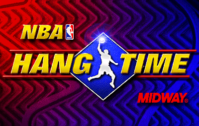 | [hangtime.md: Arcade: title screen and attract mode](hangtime.md#arcade-title-screen-and-attract-mode) | NBA Hangtime title screen |
| 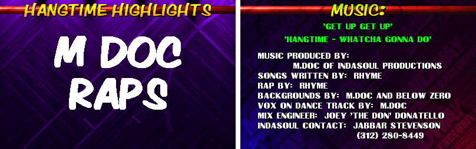 | [hangtime.md: Arcade: title screen and attract mode](hangtime.md#arcade-title-screen-and-attract-mode) | The M DOC RAPS highlights page and the MUSIC credits page |
| 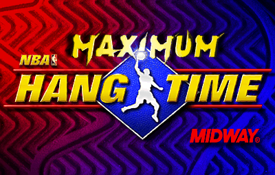 | [hangtime.md: Maximum Hangtime](hangtime.md#maximum-hangtime) | The Maximum Hangtime title screen |
| 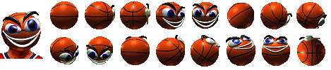 | [hangtime.md: Maximum Hangtime](hangtime.md#maximum-hangtime) | K DAY's portrait and 16 head frames |
| 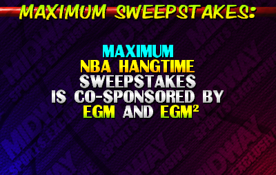 | [hangtime.md: Maximum Hangtime](hangtime.md#maximum-hangtime) | MAXIMUM SWEEPSTAKES credits page |
| 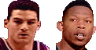 | [hangtime.md: Maximum Hangtime](hangtime.md#maximum-hangtime) | Ryan Minor and Ron Riley, the two portraits only the prototype points to |
| 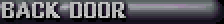 | [hangtime.md: Maximum Hangtime](hangtime.md#maximum-hangtime) | The unused BACK DOOR image |
|  | [hangtime.md: Other Genesis leftovers](hangtime.md#other-genesis-leftovers) | Genesis attract mode: Greatest Players and Experienced Players, listing the 13 names |
|  | [hangtime.md: Arcade: unused graphics](hangtime.md#arcade-unused-graphics) | Old and new Pistons, Timberwolves and Jazz logos, and the DCS Sound System logo |
|  | [hangtime.md: Arcade: unused graphics](hangtime.md#arcade-unused-graphics) | The red rule captions and the two shorter WINNER STAYS ON FREE notices |
|  | [hangtime.md: Arcade: unused graphics](hangtime.md#arcade-unused-graphics) | The unused player animation, standing frame and five portraits |

## NBA Jam at home

| Picture | Where | What it shows |
|---|---|---|
|  | [secrets.md: Super Nintendo: controller warning screens](secrets.md#super-nintendo-controller-warning-screens) | Unsupported-device screen |
|  | [secrets.md: Super Nintendo: controller warning screens](secrets.md#super-nintendo-controller-warning-screens) | Multitap warning |
|  | [secrets.md: Genesis: Iguana's crash screen](secrets.md#genesis-iguanas-crash-screen) | Iguana debug screen after an address error |
| 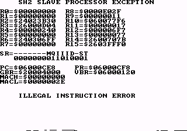 | [secrets.md: Genesis: Iguana's crash screen](secrets.md#genesis-iguanas-crash-screen) | The 32X SH-2 exception screen in BizHawk |
| 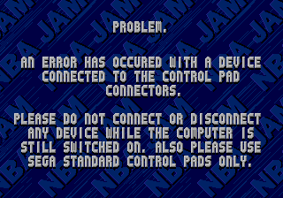 | [secrets.md: Genesis: Iguana's crash screen](secrets.md#genesis-iguanas-crash-screen) | Genesis device-error screen |
| 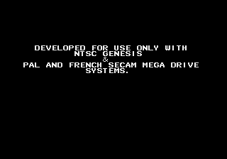 | [secrets.md: Genesis: Iguana's crash screen](secrets.md#genesis-iguanas-crash-screen) | Genesis Rev 1 region screen |

## Tournament Edition at home

| Picture | Where | What it shows |
|---|---|---|
| 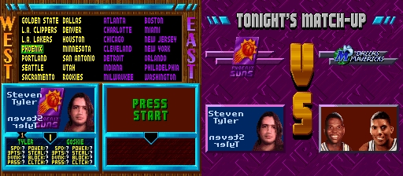 | [te_consoles.md: What's in the table](te_consoles.md#whats-in-the-table) | Steven Tyler on Super Nintendo team select and Tonight's Match-Up |
| 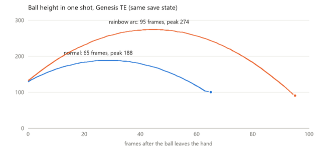 | [te_consoles.md: Match-up codes](te_consoles.md#match-up-codes) | Ball height in one shot with and without rainbow arc |
|  | [te_consoles.md: Jaguar](te_consoles.md#jaguar) | The fake CD-ROM loading screen |
|  | [te_consoles.md: Jaguar](te_consoles.md#jaguar) | Doom mode: all four players with the same head |
|  | [te_consoles.md: Jaguar keypad](te_consoles.md#jaguar-keypad) | CARTRIDGE MEMORY CLEARED |
|  | [te_consoles.md: Jaguar keypad](te_consoles.md#jaguar-keypad) | Team select with a 27-team record: Gorilla and Morty, and the All-Stars |
|  | [te_consoles.md: PlayStation: three cut characters](te_consoles.md#playstation-three-cut-characters) | The three cut characters at team select |
|  | [te_consoles.md: Checked against published lists](te_consoles.md#checked-against-published-lists) | The eight unused 32X players on team select |
|  | [te_consoles.md: Checked against published lists](te_consoles.md#checked-against-published-lists) | The Game Boy memory viewer and character viewer |
|  | [te_consoles.md: Checked against published lists](te_consoles.md#checked-against-published-lists) | Unused PlayStation portraits: Armstrong, Wilkins, Williams, Worthy |
|  | [te_consoles.md: Checked against published lists](te_consoles.md#checked-against-published-lists) | The five unused Super Nintendo courtside ads |
|  | [te_consoles.md: Checked against published lists](te_consoles.md#checked-against-published-lists) | The thirteen unused heads, 16 frames each: 0, 10, 12, 13, 17, 28, 29, 63, 65, 67, 72, 73, 77 |
|  | [te_consoles.md: Checked against published lists](te_consoles.md#checked-against-published-lists) | The fourteen unused Genesis heads, 16 frames each |
|  | [te_consoles.md: Checked against published lists](te_consoles.md#checked-against-published-lists) | The four unused 32X heads, 16 frames each, in stand-in colours |

## Betas, prototypes and regional versions

| Picture | Where | What it shows |
|---|---|---|
|  | [variants.md: NBA Jam, Super Nintendo](variants.md#nba-jam-super-nintendo) | The 11 secret characters of the Japanese beta |

## Passwords

| Picture | Where | What it shows |
|---|---|---|
| 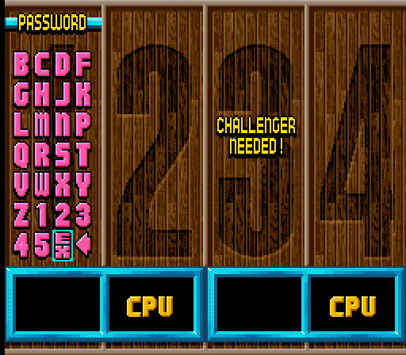 | [nbajam_password.md: Where it appears](nbajam_password.md#where-it-appears) | The password grid |
|  | [nbajam_password.md: Where it appears](nbajam_password.md#where-it-appears) | The stats screen for LJP / Z443C1WY434S2J: 27 W 0 L, streak 27 |
| 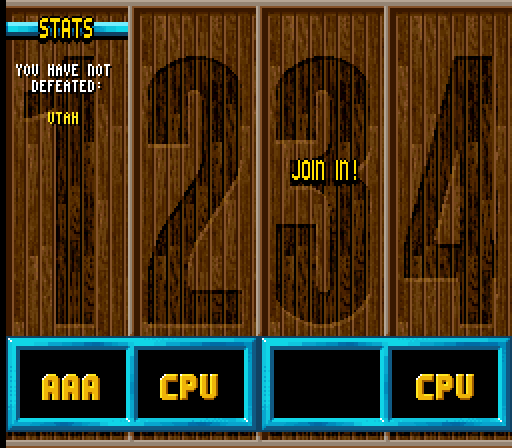 | [nbajam_password.md: Where it appears](nbajam_password.md#where-it-appears) | The second stats page: You have not defeated Utah |
