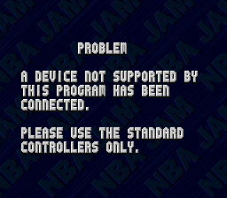
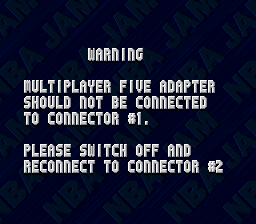
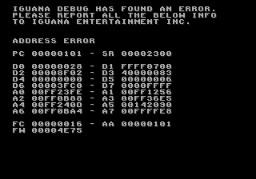

# Secret characters and initials codes

What the ROMs hold for secret initials, checked against the published lists (GameFAQs, 2026-10).

## Secret characters

Both consoles check the initials against the same 12-entry table (SNES `$29FEB0`; Genesis `$1FFDFA`,
Rev 1 `$1FD0A2`). Each entry is three initials (grid index, A = 0, blank = 26) with bit 7 set on the
third, and a character ID.

| Initials | ID | Character |
|----------|----|-----------|
| `MJT` | 54 | Mark Turmell |
| `SAX` | 55 | Weasel |
| `UW_` | 56 | Warren Moon |
| `DIS` | 57 | P-Funk |
| `ARK` | 58 | Bill Clinton |
| `NET` | 59 | Al Gore |
| `ROD` | 60 | Scruff |
| `SAL` | 61 | Sal DiVita |
| `AIR` | 62 | Air Dog |
| `RJR` | 63 | Jamie Rivett |
| `QB_` | 64 | Kabuki |
| `CAR` | 65 | Chow-Chow |

There is no 13th character. On the SNES, the per-player tables indexed by character ID (`$0D9CCE`, used at
`$8A8D9B`) are exactly 66 entries long: 54 NBA players and these 12.

**Genesis: Chow-Chow.** GameFAQs lists 11 Genesis characters and leaves out Chow-Chow (Sega Retro does list it). `CAR` works:
enter C, A, then hold Start and press C on R. Checked in BizHawk: the game matches ID 65 and the team select
screen shows Chow-Chow.

**Super Nintendo: P-Funk.** GameFAQs says to hold L and press A on the S of `DIS`. That fails in Mesen 2; the table
wants Start + L. GameFAQs' other entries say "hold Start + L, hit X" where this page says "hold Start + X + L, press A".
Both work, since X also picks a letter (checked for `AIR`, `CAR` and `SAL`).

## Game Boy

The original Game Boy NBA Jam (Beam Software) has 12 secret characters, hidden in its default player records rather
than a separate table. The records start at file offset `0x9EFE` (bank 2), 12 bytes each: three letters (A = 0, blank = 26), a
zero, wins, losses and more stats. All 22 records have bit 7 set on the third letter, which a normal entry never
produces.

The bit is added at `$2:6B78` when `$CDC5` is set. `$E:6EA1` sets it on the third letter only if the joypad byte for
that press (`$D24D`, active low: Up, Down, Left, Right, B, A, Start, Select from bit 0) equals the entry for the
**first** initial in a 27-byte table at `$E:6F78`. Every entry includes B and one direction, so the third letter is
picked by moving onto it and pressing B (plus any listed buttons) on the same frame. A plain B on the letter, or any
extra button, gives a normal player and the password screen.

| Initials | Last letter | Character |
|----------|-------------|-----------|
| `WIL` | from M, Left + B | Mark Turmell |
| `SD_` | from T, Down + B | Sal DiVita |
| `JAM` | from T, Up + B | Air Dog |
| `MAN` | from U, Up + A + B + Start | Weasel |
| `FNK` | from L, Left + B | P-Funk |
| `VIK` | from J, Right + A + B | Warren Moon |
| `EXC` | from J, Up + B + Start | Al Gore |
| `USA` | from B, Left + A + B | Bill Clinton |
| `FRD` | from E, Left + B | Kabuki |
| `BAT` | from the blank, Up + A + B | Brutah |
| `AMX` | from Q, Down + A + B | Chow-Chow |
| `RJ_` | from F, Up + A + B | Jamie Rivett |

All 12 checked in BizHawk (Gambatte): team select shows each character. GameFAQs lists all 12; its `FRD` says Right + B
from E, which lands on F, and only Left + B works. The other ten records (`CK_ ROB ZOB SNK MCM JAZ DAZ SL_ JMC JWH`)
are flagged the same way, but entering them with their first initial's buttons didn't set the flag, and they went to
the password screen like new players.

The Tournament Edition Game Boy version works differently; see [te_consoles.md](te_consoles.md#game-boy).

## Game Gear

The original Game Gear NBA Jam (Iguana) uses the same scheme as the original Game Boy, with the Super Nintendo and
Genesis initials. Its 22 default records start at file offset `0x43142` (12 bytes each, bit 7 set on the third
letter). The required inputs for the third letter, by first initial, are a 27-byte table at file offset `0xBFB3`
(active low: Up, Down, Left, Right, 1, 2, Start from bit 0). Button 1 picks letters. Both revisions (original and Rev 1)
have the same records and table.

| Initials | Last letter | Character |
|----------|-------------|-----------|
| `MJT` | from the blank, Up + 1 + 2 + Start | Mark Turmell |
| `SAL` | from M, Left + 1 | Sal DiVita |
| `AIR` | from Y, Up + 1 + 2 | Air Dog |
| `SAX` | from Y, Left + 1 | Weasel |
| `DIS` | from R, Right + 1 + 2 | P-Funk |
| `UW_` | from F, Up + 1 + Start | Warren Moon |
| `NET` | from M, Down + 1 + 2 | Al Gore |
| `ARK` | from R, Up + 1 + 2 | Bill Clinton |
| `QB_` | from T, Down + 1 | Kabuki |
| `ROD` | from K, Up + 1 | Scruff |
| `CAR` | from S, Left + 1 + 2 | Chow-Chow |
| `RJR` | from Y, Up + 1 | Jamie Rivett |

All 12 checked in BizHawk (Genesis Plus GX): team select shows each character. They match the published list
([SMS Power](https://www.smspower.org/Cheats/NBAJam-GG)). The other ten records (`CK_ ROB ZOB SNK MCM JAZ DAZ SL_ JMC
JWH`) went to the password screen, as on the Game Boy.

## Genesis: which button

On the Genesis, the last letter must be entered while holding Start and pressing the button that
**your first initial** picks (`$1D425C`, mask table `$1D426C`):

| First initial | Hold Start and press |
|---------------|----------------------|
| A E I M Q U Y | A |
| B F J N R V Z | B |
| any other letter, or blank | C |

That's why the published Genesis codes name a different button for each character.

## Genesis: speech initials

The Genesis has a second table, `$1D6728` (Rev 1 `$1D39D0`), of 18 initials that play an announcer clip
when entered with the Start code on the last letter (`$1D4ED0`). The SNES doesn't have it.

| Initials | Clip ID | Notes |
|----------|---------|-------|
| the secret characters above except `AIR`, plus `SAM` | `$22` | "It's a blowout!"; `AIR` isn't in this table |
| `GAP` | `$20` | "Hello!" |
| `CHR`, `SNK`, `JAZ`, `ZOB` | random: `$1B`, `$0F`, `$13` or `$17` | "Boomshakalaka!", "Is it the shoes?", "Ugly shot!", "Oh my!" |
| `SNK` with Start on S and K | `$26` | "Nail in the coffin!"; the published all-power-ups code; also sets `$FF1D6C` |

`GAP`, `SNK`, `JAZ` and `ZOB` are also on the Genesis default high-score table (with SL, GON, JWH and DAZ),
which suggests they're the developers' initials. Unlike the arcade's preset records, entering them (or SL, GON, JWH, DAZ) on a
fresh save gives "No record" (checked in BizHawk): the table is just the default record-keeper names. `SAM`, `GAP`, `CHR`, `JAZ` and `ZOB` aren't on the published
lists. All of them were checked in BizHawk: each one triggers the clip ID shown. Recordings are in `tools/audio/genesis_<id>.mp3`.

Tournament Edition on Genesis and 32X still holds the same table and lookup routine (Genesis `$2A8C52` / `$2A6910`,
32X `$8B92D2` / `$8B7A18`), but nothing calls the routine, so the codes do nothing there (checked in BizHawk on the
Genesis: GAP and SAM with each Start code play nothing, and the routine never runs). The Sega CD has no speech table.

## Sega CD

The Sega CD NBA Jam (Iguana, 1994) has 28 secret characters: the Genesis 12 and 16 more, mostly Iguana staff plus four
dinosaurs. The table is in `FRONT.BIN` at offset `0x3D202` (loaded into PRG RAM at `$4B202`; checked by the sub CPU at
`$1ACC2`). Each entry is three letters (A = 0, blank = 26, bit 7 on the third), a character ID and a button word.

The button word is built while you enter the letters (`$1A0D6`). A letter picked with Start held adds a value for the
button pressed with it: A = 1, B = 2, C = 4, times 1, 8 or 64 for the first, second or third letter. A letter picked
without Start adds nothing. So each character has its own combination for all three letters, not just the last one as
on the Genesis.

| Initials | Letters | Name in game | Initials | Letters | Name in game |
|----------|---------|--------------|----------|---------|--------------|
| `MJT` | Start+A, Start+C, A | Turmell | `NEH` | Start+B, Start+A, A | Bloke! |
| `SAX` | A, Start+A, Start+A | Weasel | `CK_` | A, Start+C, Start+C | Chris |
| `UW_` | Start+C, A, Start+A | Moon | `STE` | Start+A, Start+B, Start+C | Snake |
| `DIS` | Start+B, Start+A, Start+C | P Funk | `BAA` | Start+B, Start+A, Start+A | Fleece |
| `ARK` | Start+A, Start+B, Start+C | Clinton | `DAZ` | Start+C, Start+B, A | Daz |
| `NET` | Start+C, Start+B, A | Gore | `ANG` | A, Start+C, Start+A | Banana! |
| `BRT` | Start+A, A, Start+C | Brutah | `IAN` | Start+C, Start+B, Start+B | Geezer |
| `SAL` | A, Start+C, A | DiVita | `IDD` | Start+A, Start+C, A | Mr. C |
| `AIR` | Start+C, Start+B, Start+B | Air Dog | `ROB` | Start+B, Start+A, Start+C | Bob |
| `RJR` | Start+A, Start+A, Start+C | Rivett | `GJV` | Start+C, Start+A, Start+C | Gary |
| `QB_` | Start+B, Start+A, Start+B | Kabuki | `JF_` | A, Start+A, A | Jase |
| `CAR` | Start+C, A, Start+C | Chow-Chow | `MAD` | Start+A, Start+C, Start+C | The Last V6 |
| | | | `ZIG` | Start+C, Start+A, Start+B | Ziggy |
| | | | `RAP` | Start+A, A, Start+C | Velociraptor |
| | | | `REX` | A, Start+C, Start+A | T-Rex |
| | | | `TRI` | Start+B, Start+C, Start+B | Triceratops |

`BRT` (Brutah) takes ID 60, which is Scruff (`ROD`) on the Genesis and Super Nintendo. After the initials, the stats
screen waits for A, B or C; Start doesn't move it on.

All 28 checked in BizHawk (Genesis Plus GX, US BIOS v1.10): the button word and character ID match the table, and team
select shows each character. The extra characters are already published (that list wasn't compared entry by entry).

## Other button codes

The original's home versions were checked the same way as Tournament Edition (see
[te_consoles.md](te_consoles.md#other-button-codes)): every load of the pad variables followed by a button test, and
every "table entry against the new presses" loop.

- **Super Nintendo** (held `$0008`-`$000E`, new presses `$1669`-`$166F`): only Start and menu-navigation tests, plus the
  match-up power-ups (below). No title-menu sequence, no pause quit.
- **Genesis** (pads `$FF02B4`-`$FF02BA`, new presses `$FF02BE`-`$FF02C4`) and **Sega CD** (pads `$AB3E`-`$AB44`, new
  presses `$AB48`-`$AB4E`, in `FRONT.BIN` and `GAME.BIN`): no button combinations or sequences apart from the match-up
  power-ups (below). On the Sega CD those are in `MAIN.BIN`, the main CPU's program, which only reads the pads, passes
  them to the sub CPU (`$A12012`-`$A1201A`) and runs the match-up sequences. The Genesis has the same unused sound test
  as Tournament Edition (`$1C3E16`, nothing calls it).
- **Game Boy** and **Game Gear**: the usual reset, and the Tonight's Match-Up power-ups (below).

## Game Boy and Game Gear: match-up power-ups

Both handhelds have seven power-ups entered at Tonight's Match-Up, and the game prints the ones you got
("power up / defence / intercept / turbo / dunks / fire / show shot / juice mode"). They aren't sequences. Each
frame on that screen the game counts new presses of the two buttons (Game Gear 1 or 2, `$C49E`; Game Boy A or B,
`$CC33`) and, on the Game Gear only, collects which of the 8 D-pad directions you've held (`$C49F`). When the screen
ends it checks the count and the pad as it is at that moment (Game Gear `$BDD9` in bank `$10`, `$D66C`; Game Boy
`$6D09` in bank 2, `$D24D`). The press that starts a hold with a button counts too. Pressing Start to leave the screen
puts Start into the pad, so the codes that end with a hold only work if you let the screen time out.

| Power-up | Game Gear | Game Boy |
|----------|-----------|----------|
| Defence | exactly 5 presses | 5 presses, holding Up |
| Intercept | 15 or more, and all 8 directions | 15 presses, holding Right |
| Turbo | 15 or more, holding Left | 15 or more, holding Up + B |
| Dunks | exactly 13, and all 8 directions | 11, holding Down + A |
| Fire | 8, holding Up + 2 | 7, holding Left |
| Show shot % | 2, holding Down + 2 | 4, holding Up + B |
| Juice mode (toggles on GG) | 15, holding 1 + 2 | 16, holding A + B |

All 14 checked in BizHawk, with the wrong counts and Start failing. Both Game Gear revisions have the same code. They
match the published lists ([SMS Power](https://www.smspower.org/Cheats/NBAJam-GG),
[Cheat Happens](https://www.cheathappens.com/9646-Game_Boy-NBA_Jam_cheats)) except juice mode, which both give one
press short (13 then 1 + 2; 14 then A + B): that only works if the two buttons go down on separate frames, so each
counts. Cheat Happens also lists fire as 7 presses then Down + Left, which does nothing (checked). Tournament Edition
on the handhelds has no such list: its juice mode is an option on the options screen.

## Super Nintendo, Genesis and Sega CD: match-up power-ups

The three home consoles have the same seven power-ups as the handhelds. The cartridges count presses; the Sega CD
uses button sequences.

**Super Nintendo** (`$8AFDF4`, both revisions) and **Genesis** (`$1D9B22`, both revisions) count each player's new
presses during Tonight's Match-Up (SNES `$1CF9` + 2 × player, any of A, B, X, Y; Genesis `$FF1D28`), note which of the
8 stick directions were seen (SNES `$1D01`, Genesis high byte of `$FF1D30`) and, when the screen ends, the buttons
still held (SNES `$1D09`, Genesis `$FF1D30`). The press that starts a hold counts.

| Power-up | Presses | Also | SNES flag | Genesis flag |
|----------|---------|------|-----------|--------------|
| Defense | exactly 5 | | `$0AD0` | `$FF1D28` |
| Steals / intercept | 15 or more | all 8 directions | `$0AC8` | `$FF1D29` |
| Dunks | exactly 13 | all 8 directions | `$0AE8` | `$FF1E12` |
| Fire | exactly 8 | SNES Up + Y + B held, Genesis Up + B + C | `$0AE0` | `$FF1E16` |
| Turbo | 6 or more | SNES Y + B + A held, Genesis A + B + C | `$0AD8` | `$FF1E1A` |
| Shot percentage | exactly 2 | SNES Down + B + A held, Genesis Down + A + B | `$0AC6` | `$FF1D38` |
| Juice mode (toggle) | exactly 14 | SNES B + X held, Genesis B + C | `$1D39` | `$FF1D5A` |

All 7 checked on all four cartridges (Mesen 2 and BizHawk). The published lists have them, with two slips:
almarsguides' SNES shot percentage (tap once, hold B + A) leaves out Down and does nothing, and Cyberly's Genesis
"multiple power-ups" (B seven times, then hold B + C + Up, said to give fire, goaltending and turbo) is the fire code
and gives fire only. Both checked.

**Super Nintendo: juice mode from a 27-team record.** The second stats page (`$8ACA95`) counts the teams beaten. With
all 27 it prints "You have defeated all 27 NBA teams!" and sets `$1D39`, the same flag as the match-up code, for the
next game. That explains the "juice mode password" in a Super Nintendo FAQ, `HRY` / `QF3B43T QJY55TF`: it decodes to
86–0, streak 86, all 27 teams beaten. Checked in Mesen 2: that password and `LJP` / `Z443C1WY434S2J` turn `$1D39` on
when the page shows; `RAT` / `12345432123454` (18 teams) doesn't. With 14 to 26 teams the page lists the teams left.

**Sega CD.** The main CPU's match-up routine (`MAIN.BIN`, loaded at `$FF10A0`; routine at `$FF2B36`) keeps each
player's place in seven sequences (`$FF2B74` + 4 × sequence + player; `$FF` when done) and copies the result to the
sub CPU through Word RAM (`$239006`). A wrong press starts that sequence over. The sub CPU then copies the flags into
the players exactly as the Genesis does (`$010A28`-`$010AE4` in PRG RAM), which is what names them:

| Power-up | Sequence | Flag (PRG RAM) |
|----------|----------|----------------|
| Defense | A, B, C, B, C, A, Up | `$816A` |
| Fire | C, B, C, B, C, B | `$8260` |
| Intercept | Up, Down, Left, Right, Up, Down, Up, Down | `$816B` |
| Dunks | C, C, C, A, A, A, B | `$825C` |
| Turbo | C, A, C, A, C, A | `$8264` |
| Shot percentage | A, Right | `$817A` |
| Juice mode | Up, Right, Down, Left, A, B, C | game-wide (play runs faster) |

All 7 checked in BizHawk: each completes its sequence, and after tip-off the flag is set in the game (none of the
others are). None are on any list we found; Sega Retro's Mega-CD section is empty.

## Super Nintendo: controller warning screens

Every frame the pad routine (`$8AA86B`) checks two things, and either one stops the game with a full-screen message
from bank `$8D` (it disables interrupts, so only a reset gets out):

- **Unsupported device** (`$8DFD2A`): the ID bits of a pad (the low four bits of `$4218`/`$421A`, which a standard
  pad reads as zero) stay set for 16 frames (`$1CCB`), as a mouse or Super Scope would do.
- **Multitap in port 1** (`$8DFD21`): the multitap check (`$80B02B`) puts `$80` in `$1D3D`.

 

Both forced in Mesen 2 (`$1CCB` = `$10`; `$1D3D` = `$80` at `$8AA86B`). Neither is a code, but neither appears on any
list we found.

**Code that never ran.** A Mesen 2 run with an execute callback on all of ROM (attract mode, the menus, a password,
Tonight's Match-Up and a stretch of play) ran 19,403 of the 81,072 instructions the disassembler decodes. Among the
code that didn't run, the blocks that read the pads are the multitap reader (`$80B0E2`), the screens above, pause
handling and screens the run didn't reach (stats, records). No unknown button check turned up, but one run can't
reach everything, so this is not a proof.

## Sega CD: disc files

The disc's files were checked against the names in `SUB.BIN` (the loader) and the main programs. `Q1S`-`Q4S` and
`Q1S4`-`Q4S4` come from the patterns `Q?S.BIN` and `Q?S4.BIN`, and `FRONT.BIN`, `GAME.BIN` and `QUARTER.BIN` each
appear twice in the directory with identical contents (copies placed for faster seeking). `ABS.TXT`, `BBY.TXT` and
`CPY.TXT` are the standard ISO 9660 abstract, bibliography and copyright files. The one loose end runs the other way:
`FRONT.BIN` and `QUARTER.BIN` ask for `ADVERT?.VID`, and no such file is on the disc (only `ENDVID.VID` and
`HALFTIME.VID`). In `FRONT.BIN` (loaded at `$E000`) the routine at `$F3B6` puts `1`-`4` in place of the `?`, takes
that advert's two parameters from `$F3E2`, and starts the video player (`$F422`); `$F3A2` steps a counter
(`$BC2E`) through 0-3 so the four adverts would play in turn. Nothing calls either routine or the setup at `$F374`,
so the advert breaks were cut along with the files.

## Genesis: Iguana's crash screen

Both Genesis revisions point the 68000's error vectors (bus error, address error, illegal instruction and so on;
`$141262`-`$14137E` on the original) at a crash screen that prints the error and every register: "Iguana debug has
found an error. Please report all the below info to Iguana Entertainment Inc." It's a leftover from testing; the
finished game only reaches it if the CPU faults. Forced in BizHawk by putting an odd return address on the stack:

Tournament Edition on Genesis sends every vector to one handler and has no such screen.

The Genesis also has a device-error screen like the Super Nintendo's ("An error has occured with a device connected
to the control pad connectors..."). The Team Player reader (`$1D9E28`) shows it when the adapter's header isn't
`$030F0000` for 36 reads in a row (`$FF1D5C`). It only runs with a Team Player detected, so it wasn't forced.
