# Tournament Edition on Super Nintendo, Genesis, 32X, Saturn, PlayStation, PC, Jaguar, Game Boy and Game Gear: secret players

All three home versions of NBA Jam TE check the initials against one 40-entry table:

| Version | Table | Entry size |
|---------|-------|------------|
| Super Nintendo | `$29:8A7F` (checked at `$8A:DA96`) | 6 bytes |
| Genesis | `$2DC1EA` (checked at `$2A682C`) | 6 bytes |
| 32X | `$05BDD6` (ROM offset) | 6 bytes |

An entry is three letters, the character ID and a 16-bit button word. Each letter is its grid index (A = 0, blank = 26)
with bit 5 set if Start must be held on it. The button word has 3 bits per letter, first letter lowest: 1, 2 or 4 for
the button pressed with Start (Genesis A, B, C; Super Nintendo A, B, Y). The game compares all four values, so a letter
marked plain must be entered without Start.

The 32X stores the button word in the other order, so its codes run the other way from the Genesis ones. TWG is
Start + B, plain, Start + A on Genesis and Super Nintendo, but Start + A, plain, Start + B on the 32X. RQ87's list is
correct for the 32X.

## What's in the table

- **38 characters work on Genesis and Super Nintendo**, plus **Stud Muffin** (`G_F`, ID `$9A`), which also needs a
  flag set during the power-on copyright screens: hold Start + C + Left on Genesis (`$FF2296`, set at `$2AC78A`), or
  Left + L + R on Super Nintendo (`$1E28`, set at `$89:9432`). All 39 checked: Genesis in BizHawk, Super Nintendo in
  Mesen 2.
- **The 32X has 36.** Scooter Pie (`HTP`), Kid Silk (`KSK`), Stud Muffin and Steven Tyler have their letters set to 28,
  which the grid can't enter. Snake is `SNK` there instead of `GOF`. Checked in BizHawk.
- **Steven Tyler** (ID `$7A`, between Prince Charles and Chow-Chow) is cut from all three. His initials are letter
  values the grid doesn't have (Genesis 31/27/27, Super Nintendo 27/27/27 where 27 is the delete arrow). Forcing the ID
  into the player slot on Genesis shows the name "TYLER" with a blank portrait.
- On Super Nintendo, press Start before the button: when Start and B or Y go down on the same frame, the Start flag
  isn't recorded and the code fails (seen in Mesen 2).

Published lists checked: the cyberly.org Genesis list matches the table for all 38 it gives. The almarsguides
Super Nintendo list gives Weasel (`RAY`) as Start + Y on the Y; the table wants a plain press there, and Start + Y fails
(checked).

The Genesis and 32X ROMs also hold eight default record-keeper initials just before the table
(`CER SNK CLD MC_ JAF APF EMK DAN`). They're copied into the save records with the secret slots and aren't unlocks.

## Other button codes

Every read of the pad variables was followed: Super Nintendo `$08`-`$0E` (held) and `$14D7`-`$14DD` (new presses),
filled at `$8A:AE73`; Genesis `$FF0288`-`$FF028E` (held) and `$FF0292`-`$FF0298` / `$FF1116`-`$FF111C` (new presses).
Much of the Super Nintendo menu code isn't reached by the disassembler, so the raw ROM was also scanned for every load
of those variables followed by a button test, and for every "table entry against the new presses, then step an index"
loop. Apart from the initials screen and Stud Muffin's flag, that leaves:

- **All-Star record.** On the title menu (Head to Head, Team Game, Practice, Options), press Y (Genesis C), Up, Down,
  B, Left, A, Right, Down on any pad. Super Nintendo checks it at `$8A:8837` against `$96:FC3A` and sets `$16FF`;
  Genesis at `$28C388` against `$28DB92` and sets `$FF227A`. A record then kept as **JAM** is created 27-0 with every
  team beaten, so ALL-STARS replaces ROOKIES on team select; **END** is created 26-0, last played Chicago, one team
  short (`$8A:DB75`, `$2A69E0`). Checked in Mesen 2 and BizHawk, ALL-STARS seen on both. The published Genesis
  list has the JAM code; END is on no list we found.
- **Quit to title (Super Nintendo).** While paused (Start held), L + R on any pad jumps to the reset entry (`$80:8AC9`).
  Checked in Mesen 2 mid-game.
- **Sound test (Genesis, unused).** `$28AE4A` is a loop where Left/Right pick a sound number, B plays it and Start
  leaves. Nothing in the ROM calls it.

The other versions were checked for the same thing by scanning their code for 8-entry button tables shaped like these
sequences, and for preset records:

- **32X.** It runs the Genesis 68000 code with the same pad variables, but its title-menu sequence is different:
  C, Up, Right, Down, Left, A, Right, Down (`$29F70`, table at `$8AB316`, sets `$FF227C`). The initials it then
  rewards are **FIN** (27-0, ALL-STARS replaces ROOKIES with an "EXPANDED ROSTER" note) and **PRE** (26-0, last played
  Chicago), at `$37AEE`. Its sound test sits unused at `$28826`. Checked in BizHawk; on no list we found.
- **PlayStation and Saturn.** No title-menu sequence. Instead a new save is filled with preset records
  (PlayStation `SLUS_000.02` file offset `0x1550`, Saturn `0` offset `0x8B6A`): **END** and **FIN**, both dated
  January 1, then CHR, DAZ, TOM and ZIG dated 99/99, which the date grid can't enter. Keeping a record as FIN, January 1
  opens a 27-9 record, rank 1st ("You have defeated all 27 NBA teams!"), which is the published "champion" code; END,
  January 1 opens 26-9, rank 2nd, with only Houston left. No buttons need to be held. Checked in BizHawk on both.
  Sega Retro's Saturn page lists both; we found END on no PlayStation list.
- **PC, Jaguar, Game Boy, Game Gear.** No sequence tables and no preset records found. The two handhelds do have a
  quit from pause, read from the code only: on Game Boy, Select pauses and A + B while paused sets game state 10
  (`$13E28`), which waits and restarts at the title; on Game Gear, 1 + 2 + Start pauses and 1 + 2 while paused sets
  state `$0A` (`$29966`).

## Match-up codes

Every version keeps its Tonight's Match-Up codes as a table of button sequences, so the game holds the complete list.

**Super Nintendo, Genesis and 32X.** Each new press goes into a per-player history (SNES `$7E2258`, Genesis
`$FF217E`, `$20` bytes per player; one byte per press: Up `$10`/`$01`, Down `$08`/`$02`, Left, Right, A, B; X, Y
and C aren't recorded), and when the screen ends the game searches it for each sequence in its table
(SNES `$8A:FA37`, table `$4C:EFDA`; Genesis `$2ACF5A`, table `$2AD01E`; 32X `$3D5BE`, table `$8BD67C`). An entry is
the sequence, an end byte, then the address of the flag it sets. The flags are copied to the players when the game
starts (Genesis `$266762`, 32X `$12D82`; SNES packs them into a mask at `$07EE`, around `$82:F9D8`).

- Super Nintendo and Genesis share the same 17 sequences. The cyberly.org Genesis list has 16 of them right. One
  Super Nintendo list has three wrong: three pointers without the last Up, teleport pass with an extra Left, and
  rainbow arc shots without the first Up. None of those versions sets anything (checked in Mesen 2).
- **The 17th code is unused:** Down, Up, Down, Up, Down, Up, Left, Left, B, B. The game recognises it and sets its
  flag (Genesis `$FF2312`, SNES `$0B82`, both checked), but never applies it. The Genesis and 32X copy loops step over
  it (`adda.w #8, a0`), and on Super Nintendo it becomes mask bit `$4000`, which nothing tests. Probably a cut
  power-up. It isn't on any list we found.
- **The copy loops, checked in play.** After tip-off, each per-player code's flag shows up as 1 in its own field of
  player 1's struct (Genesis `$FF4446` + `$12C`-`$146`, 32X `$FF6730` + `$12E`-`$14A`); the unused code sets none.
  Shot percentage and baby mode are global, not per player. Checked in BizHawk on both.
- **The 32X has its own 18 sequences**, for the same effects in the same order plus baby mode (a global flag,
  `$FF4610`). All 18 checked in BizHawk: each sets its flag. RQ87's list has six of them, and gives turbo without
  its second Down, which does nothing (checked); the other twelve, including the unused code, weren't on any 32X
  list we found. Lists that give the Genesis codes for the 32X are wrong: those sequences aren't in its table.
- **PlayStation** (`OVERLAY.BIN` `0x2AD88`, 19 sequences, checked at `$801D5CF0`) and **Saturn** (`0` `0x578A4`, the
  same 19 in the same order, checked at `$0604A09C`) hold nothing new. Each searches the player's history (PlayStation
  `$801F3564`, Saturn `$06073E38`, 30 presses per player); sequences 1-14 set bits in the player's mask (`$80084308` /
  `$06070B94`) and the other five set global bytes. All 19 checked on both in BizHawk. The PlayStation's match the Cheat Code Central list exactly, except
  that mammoth heads is stored as four rounds of Circle, X, Square, Triangle, not five. The Saturn's two that differ
  from the PlayStation's (turbo and push) were published by 32bits. Sega Retro's Saturn page has 17 of the 19, all
  matching (its baby mode and head codes are longer than needed, which still works); it lacks Y, Y, Y, B, Down, Down, Up, Left and
  Down, Right, C, Y, C, Right, Down.
- **Super Nintendo and Genesis at tip-off.** Super Nintendo prints the code's name under the jump circle for the
  first ten codes ("QUICK HANDS", "MAX POWER", "POWERUP G.T."...), and "SHOT % DISPLAY ACTIVATED" across the table.
  Genesis shows shot percentage the same way, and the power-up names replace player 1's name above the court at
  tip-off. On both, the two push codes, super speed, teleport pass, slippery court, the unused code and rainbow arc
  print nothing. Screenshots on the codes page, each with a random secret character (BizHawk).
- **What tip-off shows** (codes-page screenshots, each with a random secret character, BizHawk). PlayStation and
  Saturn: player 1's power-up name at the bottom left ("QUICK HANDS", "MAXPOWER", "POWERUP FIRE"...) while the player
  flashes white, and the global codes' message at the top ("SHOT PERCENT DISPLAY!", "BABY MODE!", "HUGE MODE!", "BIG
  HEAD MODE ON!", "MAMMOTH HEAD MODE ON!"). Both push codes, teleport pass, rainbow arc shots and super speed print
  nothing. The flash alternates every few frames while the caption stays up, so the screenshots are frames where the
  player is drawn normally. The code listed as huge heads makes every player bigger, not just the heads: its message
  is "HUGE MODE!". The 32X prints nothing at tip-off. Its global codes print a line once play starts ("SHOT %
  DISPLAY ACTIVATED", "BABY MODE!"), and a power-up's name ("QUICK HANDS", "PWRUP G.T.", "PWRUP PUSH") replaces the
  player's name only when it comes into play, so a random-input game catches some and not others. The other six
  show the same way a few seconds into play: "MAX POWER", "PWRUP FIRE", "PWRUP TRBO", "PWRUP OFF", "PWRUP 3PTS" and
  "PWRUP DUNK". All 17 32X codes were confirmed set in player 1's struct.

## Jaguar

The Jaguar version (by High Voltage) has its own 40-entry table at `$860CE0` (file offset `0x60CE0`; the count, 40,
is the long at `$860CDC`). An entry is 8 bytes: three ASCII initials (`[` is the blank), three button bytes, then a word
with the character ID. The check at `$807F00` compares the initials and button bytes as entered and stores the ID at
`$5EDA` (player 1).

Any of A, B or C picks a letter. The button byte comes from `$8080FA`: `$FF` for a normal press, or, while **Option** is
held, the joypad bit number of the button pressed (A = `$1D`, B = `$19`, C = `$0D`). So each letter is either "as usual"
or "hold Option and press A/B/C".

- **All 40 work**, with no power-on step. Checked in BizHawk (Virtual Jaguar core): each code gives "SECRET PLAYER" and
  the expected ID. That includes Stud Muffin's and Steven Tyler's slots.
- **16 slots hold different people.** Six High Voltage staff take the Midway staff slots (`RBG`, `ALP`, `KJG`, `DJD`,
  `K_M`, `HAM` instead of `SL_`, `JMC`, `KSK`, `TWG`, `CK_`, `HTP`). Phil Gelber (`FIL`), L. Pacey (`PAY`), Correll (`CRL`),
  Faran Thomason (`FAR`), Kristine Chambers (`KC_`, Tyler's slot), Leonard Tramiel (`LAT`), Theinvanich (`THE`),
  Shawn Rosen (`SR_`), Wanat (`WAN`, Stud Muffin's slot), Gunter (`GUN`) and Seth Rosenfield (`SET`) replace the others.
- The published Jaguar list ([consoledatabase.com](https://www.consoledatabase.com/cheats/atarijaguar/nbajamtournamentedition/))
  matches the table except **Mike D**: it gives as usual, B, A, but the table wants Option + C on M and on D (checked).

**Match-up codes.** The Jaguar has its own 24 sequences. Each player's presses go into a 256-byte history
(`$705D` + `$100` × player), and when the screen ends `$80A24C` searches it for each sequence in the pointer table
at `$81C36C` (file offset `0x1C36C`). A sequence is the joypad bit numbers of its presses (Up `$14`, Down `$15`,
Left `$16`, Right `$17`, A `$1D`, B `$19`, C `$0D`), with bit 7 set on the last one. Sequence *n* sets bit *n* of the
player's mask (`$6922` + 4 × player); `$80A1D8` ORs the four into `$6932` and turns the global ones on, and `$80B432`
copies the rest into each player. `$80B24E` lists the active ones at tip-off under "CHEATS ACTIVATED".

The consoledatabase.com list linked above has all 24, each with the same inputs as the table, so there's nothing
new here. In table order: CD-ROM mode, baby mode, shot percentage, quick hands, goaltending, on fire, turbo,
offense, three pointers, dunks, push, push (both fall), push (other falls), teleport pass, high shots, speed,
slippery court, big heads, small heads, small ball, small players, all players on fire, Doom mode, strength (max
power). All 24 checked in BizHawk: each sets its bit. The screen is short, so a long code has to be entered as soon
as it comes up.

Two of the names say little about what they do. **CD-ROM mode** (`$6914`) puts up a fake loading screen before the
game (`$80AB76` calls `$809776`): "LOADING, PLEASE WAIT", "CD-ROM MODE EMULATION", held for `$4B0` (1200) frames,
about 20 seconds. **Doom mode** (`$691E`) makes `$804F5A` give every player the same head graphic (`$BB8430`).
Both checked in BizHawk.

  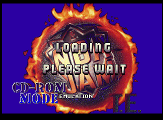
  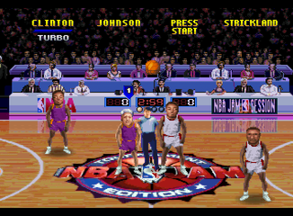

**Screenshots.** BizHawk's Jaguar core (Virtual Jaguar) draws the scorer's-table ads as stripes, so the Jaguar
match-up screenshots on the codes page come from BigPEmu. Its scripting (C compiled to a `.bigpcvm` module) can set
the pad each frame and save and load states. The script entered each code with a random secret character and
signalled a window capture at fixed frames. Tip-off prints "CHEATS ACTIVATED" and the code's name for 18 of the 24.
The push, teleport, high shots, super speed and slippery court codes print nothing; CD-ROM mode, small heads, small
ball, small players and Doom mode change the picture instead. The ad boards are the NBA and NBA Jam Session pair, as on
the other consoles.

### Jaguar keypad

Keypad keys are bits of the pad word (`$4660` + 8 × player): # `0`, 9 `1`, 6 `2`, 3 `3`, 0 `4`, 8 `5`, 5 `6`, 2 `7`,
* `16`, 7 `17`, 4 `18`, 1 `19` (Option `9`, C `13`, Up `20`-Right `23`, B `25`, Pause `28`, A `29`). Every place the
game tests them:

- `$804502`, during the boot screens: Left + 1 + 4 + 6 + 9, story mode (published).
- `$806BAA`, as team select opens: 1 + 5 + 9 extended rosters, 2 + 4 + 6 a 26-team record, 4 + 7 + 8 a 27-team record
  (all published).
- `$80332E`, every pad read: * + # on any pad jumps to the reset at `$80210A`, the standard Jaguar soft reset.
- `$804404`, after a soft reset (`$1FFFAE` set): * + # + Option resets the saved options (`$81826C`) and shows
  **"CARTRIDGE MEMORY CLEARED"** (`$6914` = -8). Not on the published list. Checked in BizHawk.
- After the 27-team check (`$806C0E`): if any player's record has beaten all 27 teams and Tournament Mode is off, the
  extended rosters open (`$5F28`), and **each player without a secret character gets a 1-in-5 chance** (1 in 8 when
  their record's byte 6 is set) of a random character from the secret table (`$860CE0`). BizHawk's Jaguar core doesn't
  send keypad 0 to 5, so 4 + 7 + 8 can't be pressed; instead a read callback set player 1's teams-beaten byte (`$5F36`)
  to 27 just as the check read it. Team select then showed the All-Stars and both slots as random secret characters
  (Gorilla and Morty).

  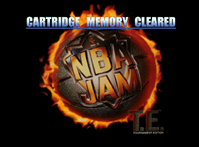
  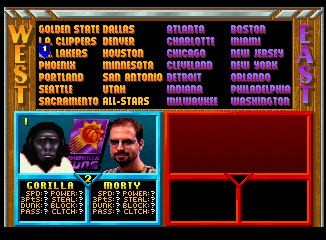

## Game Boy

The Game Boy version (by Torus Games) has 14 secret characters. The initials are plain ASCII at `$177C` (bank 0), 3
bytes each, ending in `$FF`: `CIC HC_ GOR HVY JAZ WIL SOX PHI BRD MKD ADR MCA RPR CRN` (the blank is a space). The
check at `$470C` (bank 1) finds the initials, then compares the button used on each letter, saved as `$FFE0 & $0B` at
`$D5CA`, with 3 bytes of a 7-byte entry at `$40C6` (bank 1): `$01` = A, `$02` = B, `$08` = Start. A, B and Start all
pick a letter, so each code is a button per letter. A match stores the entry number + 1 in the player's slot (`$D5CA`).

All 14 checked in BizHawk (Gambatte): each sets the slot, and team select shows the character (for example "B CLINTON").
The same initials with the wrong buttons give a normal player. They match the published list
([chaptercheats.com](https://www.chaptercheats.com/cheats/gameboy/578/nba-jam-tournament-edition-cheat-codes)) exactly.
`RPR` is RP Rodent, the Torus Games mascot from the boot screen.

The rest of the Game Boy's button tests (held `$FFDE`, new presses `$FFDD`/`$FFDF`) are menus and play, plus a pause
menu at `$13E00`: in a game, Select pauses, Select again resumes, and holding A + B sets the main mode (`$D58E`) to 10,
which fades out and restarts at the title (`$0A6E`). The Game Gear (held `$C69C`, new presses `$C69D`) has the same
idea at `$29966`: 1 + 2 + Start together pauses, Start resumes, and 1 + 2 quits to the title (`$C69A` = 10). Read
from the code. Neither has other button codes.

## Saturn

The Saturn version (Iguana) checks initials and a birthday, like the arcade TE. I read the table from high work RAM
once the game has loaded (the disc image wasn't extracted), at `$060667EC`: 53 entries of 24 bytes,
six big-endian longs each: a pointer to the player's record (name, stats), the three initials as ASCII, the day and
the month. The pointer gives each entry's name (`KITZROW`, `FOX`, `MAGIC HAIR`, ...).

All 53 checked in BizHawk (Saturnus, US BIOS `mpr-17933`): each shows "SECRET PLAYER" and then the character at team
select. They match the GameFAQs list except **Mark Turmell**: GameFAQs says `TUR` January 3, which shows "NO RECORD";
the table has January 31, which works. GameFAQs also says to hold L + R while entering, and that's right: each letter is stored with the L and R bits of
the pad (`$06043788`), and the secret check (`$0603F408`) compares it with the table letter OR'd with `$00880000`, so
every letter must be picked with L + R held. `TUR` and `FOX` without them show NO RECORD (checked).

The lineup is bigger than the cartridge versions. Besides the usual staff, mascots and celebrities it has twelve
more entries named only by their record (`CAT`, `BAR`, `HOG`, `SAT`, `BAA`, `TOM`, `LIZ`, `STH`, `SAW`, `THI`, `WAN`,
`GUN`), the announcer Tim Kitzrow (`KIT`), Fox (`FOX`), and the four members of Sonic Youth (`GOR`, `REN`, `SHY`, `MOE`).

### Saturn program: other input checks

The main program (file `0`, loaded at `$06010000`) was disassembled to look for codes beyond the tables:

- **Pad.** The SMPC data is parsed into `$060724B4` (one word per player, active high: Right `8000`, Left `4000`,
  Down `2000`, Up `1000`, Start `0800`, A `0400`, C `0200`, B `0100`, R `0080`, X `0040`, Y `0020`, Z `0010`,
  L `0008`). `$06018894` turns it into new presses and held buttons for each player, raw at `$0606C0B4` and remapped
  to the button config at `$0606A00C`.
- **Sequences.** The press-history matcher (`$0604A348`) has a single caller, the match-up screen (`$0604A0A4`),
  which checks exactly the 19 sequences in the table. There are no other sequence codes.
- **Combinations.** Nothing compares a pad word with an exact multi-button value. The L + R bits are stored with
  each initial (`$06043788`) for the secret check, and R and Z presses are counted per team in one game phase
  (`$06022376`), which looks like jump-ball tapping.
- **Tournament Mode** (`$0606B564`, saved with the options) switches off both secret players and match-up codes.

Not covered: functions that read the pad through a computed pointer were only skimmed, and BizHawk's Saturn core
can't log which code reads memory, so they weren't traced live.

## PlayStation

The PlayStation version (Iguana) uses the same table format as the Saturn, little-endian. It's in `OVERLAY.BIN` on the
disc at offset `0x2F324` (the file loads at `$801BF000`, so the table is at `$801EE324`): 53 entries of a record
pointer, three ASCII initials, day and month. I read it straight from the disc image with a small CHD reader (the
data track is `cdlz`/`cdzl` hunks; the audio tracks are FLAC and were skipped).

It's the Saturn list without Tim Kitzrow (`KIT`) and Fox (`FOX`), plus `JAX` March 1 (record "JAX") and `ROB`
February 23 (record "GRAY"). Turmell is January 31 here too. Both extras are on a published list
([Cheat Code Central](https://www.cheatcc.com/?p=85106)).

All 53 checked in BizHawk (US BIOS `scph5501`): each shows "SECRET PLAYER" and then the character at team select.
Unlike the Saturn, **L1 + R1 must be held** on the letter and date presses: without them `TUR` January 31 shows
"NO RECORD".

### PlayStation: three cut characters

The roster in `OVERLAY.BIN` (records of `0x34` bytes from `0x2BE04`, name at `+0x1B`) has 56 secret records, but the
code table points to only 53. The other three are finished characters with no code:

| Record | File offset | RAM | Between |
|--------|-------------|-----|---------|
| `WRIGHT` | `0x2BE6C` | `$801EAE6C` | Catling and Hutchinson |
| `KITA` | `0x2C248` | `$801EB248` | Kabuki and Max |
| `SPRITE BOY` | `0x2C318` | `$801EB318` | Sequoia and Boo-Boo |

Their portraits are in `HIDDEN.BIN` (`cd_data\hidden.bin`), an RNC file of 56 blocks of 4096 bytes in roster order:
a 256-colour palette (15-bit, little-endian), then a 64 × 56 8-bit image. Blocks 1, 22 and 26 match no character on any
version; the other 53 match the PlayStation portraits.

Checked in BizHawk (`tools/tests/ps_cut_characters.lua`): with the `CAT` entry's pointer (`$801EE324`) changed to each
record, `CAT` January 2 shows "SECRET PLAYER", and team select shows the cut character with name, stats and portrait.
All three play a game normally.

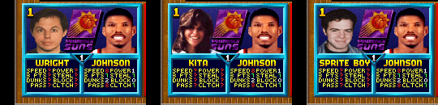

The Saturn roster has none of them (it drops `JAX` and `GRAY` too, and adds `KITZROW` and `FOX`).

**Other versions, same check.** Saturn: all 53 secret records in file `0` (from `$06063368`) have a code. PC: the front
end names exactly the 53 characters its table holds. Super Nintendo, Genesis and 32X: the only name without a code is
Steven Tyler (above). Jaguar: the name table (16 bytes per ID, from `0x1D06E`) has one entry nothing else explains,
**`BLARG`** (ID `$8D`), sitting among the extra NBA players (`$82`-`$97`) between Strickland and Dumas. No code points
to it. Forcing the ID into the secret-player slot freezes the game at team select, but so does a real extra player's
ID (`$93`, Rozier), so that test says nothing. A cleaner one: the ROOKIES team's player pairs are a word list at
`$81D01A` (Dumas, Montross, Kidd, Rose and Hill), and B on player select steps through them. With Dumas's `$8E`
replaced by `$8D` in cartridge memory (BizHawk; a patched ROM file fails the Jaguar's boot check), the emulator hangs
on the press that would show BLARG, while the same press on the unpatched game shows Dumas and Montross and plays
normally. BLARG does have its own entry in a 202-entry per-player table at `$A71508` (2,532 bytes at `$ABBE1C`, no
other entry is the same), but that table isn't the player-select portraits or the heads on court: pointing Dumas's
entry at BLARG's data changes nothing on screen. So BLARG is a name and an ID with some data behind it, but not
enough to be shown; most likely a placeholder for a player who was never finished.

## PC (MS-DOS)

The PC version (Iguana, 1995) splits into a front end, `)-----(.EXE`, and the game, `(O)_(-).EXE`, both DOS/4GW
(LE format) programs started by `JAM.COM`. The table is in the front end at file offset `0x8C6D6` (linear `$8E8D6`):
53 entries of 8 bytes: character ID, three ASCII initials (space for a blank), day, month and two zero bytes. It's the
PlayStation list with `SEM` October 23 ("SEMMENS") in place of `ROB` (Gray), and `JF_` instead of `JAS` for Jason
Falcus (same November 16 birthday).

The check (`$1C84E`, one copy per player) also compares five bytes per entry from a second table `0x1C0` bytes before
it. They're keyboard scan codes for the F-keys (`$3B` = F1 ... `$44` = F10). The keyboard handler (`$126C5`) keeps the
last F-key pressed at `$9ACF2`, and each pick on the initials and birthday screens (three letters, month, day) stores
it (`$1CDC4`). So before each of the five picks you press one F-key. The table cycles through four sequences:
F1-F5, F6-F10, F10-F6 and F5-F1.

The published PC list has 51 of the 53 with their F-keys. Two aren't on it: `AIR` January 21 (Air Dog) and `BAA` July
12 (McHugh), both F6-F10. They're on the PlayStation and Saturn lists with the same initials and birthdays, so they
aren't marked new. One is wrong: it gives Chris Kirby (`CHR` December 18) as F6-F10, but the table has
F10-F6. Checked: F6-F10 gives a normal player, F10-F6 gives Kirby.

**Match-up codes.** The match-up screen is in the front end, which passes the results to the game in
`CONTROL.DAT`. While its 240-frame countdown (`$9ACBC`) runs, `$1B15D` takes each player's input word (`$92099` +
2 × player: Up `1`, Down `2`, Left `4`, Right `8`, Turbo `10`, Shoot `20`, Pass `40`) on every new press from
nothing held, and steps through 19 sequences at `$9958C`. Each is halfwords ending in `FFFF`, then a flag dword
that is ORed into the player's mask (`$9B402` + 4 × player). A wrong press restarts that sequence. At the end
(`$1B301`) the bits `3E00` are shared with all four players. The game reads the masks at `$6DDC2` (copied to
`$6BFA4`).

The per-player bits are the PlayStation's (`1`-`100`, `8000000`-`80000000` in the same order), so the effects follow
from its list. All 19 checked in DOSBox-X: each sets its flag in the front end.

At tip-off the PC prints the power-up under player 1's name for the first nine table entries ("QUICK HANDS", "MAX
POWER", "GOAL TEND", "ON FIRE", "TURBO", "OFFENSE", "3 POINTERS", "MEGA DUNKS", "HARD PUSH"). Both push codes,
teleport pass, rainbow arc, super speed, shot percentage and big-body mode print nothing. Baby mode, big heads and huge
heads change the players instead. The codes page's screenshots were taken this way, each with a random secret
character, in a muted DOSBox-X window driven by `drv.py`.

| Effect | Keys | Flag | GG Mania |
|--------|------|------|----------|
| Quick hands | Down, Turbo, Down, Turbo, Down, Turbo | `1` | yes |
| Maximum power | Left, Turbo, Right, Turbo, Up, Turbo | `2` | yes |
| Goaltending | Turbo, Turbo, Up, Turbo, Turbo | `4` | yes |
| On fire | Shoot, Shoot, Down, Shoot, Shoot | `8` | yes |
| Turbo | Down, Down, Down, Turbo, Turbo, Turbo | `10` | yes |
| Offense | Turbo, Turbo, Turbo, Shoot, Shoot, Shoot | `20` | no |
| Three pointers | Shoot, Shoot, Shoot, Up, Up, Up | `40` | yes |
| Dunks | Left, Right, Up, Down, Left, Right | `80` | yes |
| Push | Left, Left, Right, Right, Up, Up | `100` | no |
| Push, both fall | Turbo, Left, Turbo, Turbo, Turbo | `8000000` | no |
| Push, teammate falls | Shoot, Up, Shoot, Shoot, Shoot | `10000000` | no |
| Teleport pass | Turbo, Down, Turbo, Turbo, Turbo | `20000000` | no |
| Rainbow arc shots | Shoot, Right, Shoot, Shoot, Shoot | `40000000` | no |
| Super speed | Turbo, Turbo, Shoot, Shoot, Turbo, Turbo | `80000000` | no |
| Shot percentage | Up, Shoot, Up, Shoot, Up, Shoot | `200` (all) | yes |
| Baby mode | Turbo, Shoot, Turbo, Shoot, Turbo, Shoot | `1400` (all) | yes |
| Big body | Up, Up, Up, Turbo, Shoot, all four arrows at once | `800` (all) | wrong |
| Big heads | Down, Down, Down, Shoot, Shoot, Shoot | `1000` (all) | yes |
| Huge heads | Up, Down, Up, Down, Turbo, Shoot | `2000` (all) | no |

- **Three codes do nothing in the game.** Nothing in `(O)_(-).EXE` tests `200` (shot percentage) or `800` (big
  body). Super speed is tested at `$176F0` as `(mask AND 80000000h) = 1`, which is never true. Checked in play
  (keys written into the game's key table at `$5CAFC`): each flag reaches the game's masks (`$6BFA4`), but no shot
  percentage appears when shooting and the bodies stay normal size, while big heads, run the same way, show. For super
  speed, player 1's x position (`$6CFC0`) was sampled while running: with the code, the speed matched normal; with the
  test patched to `cmp eax, 0` / `je` (bytes `83 F8 00 74 0D` at `$176FB`), it rose by about half (15.7 to 24 million
  position units a second, the medians of 30 samples), the 1.5 × the code was meant to give. Huge heads also checked in play.
- **Big body** really ends with Up, Down, Left and Right pressed on the same frame (`000F`): possible on the
  keyboard, not on a joystick. GG Mania's plain Up does nothing (checked).
- **Heads.** Normal heads are drawn at 0.625 × (`$2C811`); `1000` (big) skips the scaling, `2000` (huge) uses
  1.375 ×. `400` halves the body sizes (`$2C4CC`), so baby mode is small bodies with big heads.
- GG Mania's list ([ggmania.com](https://www.ggmania.com/gimmecheat.php?cheat=5447)) has 11 of the 19; the other
  eight weren't on any PC list we found.

**Keyboard.** Apart from the F-keys for secret characters, the front end and the game test only Esc, Enter and Pause
directly, and otherwise only whether any key was pressed; the game's typing buffer (`$5CAF9`) is never turned on. So
there are no typed codes. The front end has a leftover `/DEBUG` switch ("JAX: Debug mode invoked", a load and memory
log from Iguana's engine); run as `JAM /DEBUG` it printed nothing extra.

Player 1's keys come from `JOYSTICK.CAL`: the arrow keys, and Right Alt, Right Ctrl and Right Shift as the buttons.

All 53 checked in DOSBox-X 2026.10.01: the five stored keys and the character ID match the table, and team select shows
each character. The test drove the game from outside: DOSBox-X's `AUTOTYPE` for the title menus, then key presses and
the F-key byte written into the front end's memory (found by searching the DOSBox-X process for the table).

## Game Gear

The Game Gear version (Iguana) works like the Game Boy one. The initials are plain ASCII at file offset `0x7B433`:
`CIC HC_ GOR HVY JAZ WIL SOX PHI BRD MKD ADR MCA HGO CRN`, with Hugo (`HGO`) where the Game Boy has RP Rodent. The check
(file `0x7CD02`) then compares the button used on each letter with 3 bytes of a 7-byte entry at file offset `0x7C000`:
`$10` = button 1, `$20` = button 2, `$40` = Start. All 14 checked in BizHawk, and they match the published list
([SMS Power](https://www.smspower.org/Cheats/NBAJamTE-GG)).

## Checked against published lists

Claims from published lists that could be tested here, and what came of them:

- **32X: eight unused players.** Writing a player ID into a slot (`$FF1F24` + 2 per slot) on team select brings them
  up: James Worthy ($04, with his own portrait), Scooter Pie ($6B), Kid Silk ($6C), Steven Tyler ($7A), Juwan Howard
  ($83), Shaquille O'Neal's slot, named Green ($8D), Clifford Rozier ($93) and Greg Fischbach ($9A). Checked in BizHawk.

  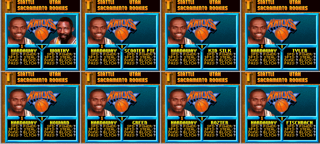

- **Game Boy: debug viewer.** Game Genie `6B1-9DF-5D3` (one byte at `$019D`, `$6E` to `$6B`) re-enables it: in a game,
  Select + A + B opens a memory viewer, and Select switches to a character viewer. Checked in BizHawk by patching the
  byte.

  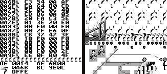

- **PlayStation: four unused portraits.** `PRESQUAT.GFX` holds RNC-packed portraits (a 256-colour 15-bit palette,
  then 64 × 56 8-bit pixels) of B.J. Armstrong, Gerald Wilkins, Monty Williams and James Worthy at `0x28266`,
  `0x2B6D9`, `0x41B11` and `0x461CC`. None has a roster record. Unpacked here with `tools/rnc.py`.

  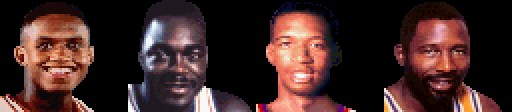

- **Super Nintendo: five unused courtside ads.** The 17 scorer's-table ads are 9 × 5 tiles of uncompressed 4bpp
  graphics at `0x2C0000` + 0x5A0 each (`$58:8000`). Every so often the routine at `$3F:D371` picks a random pair 0-7
  (`$1726` AND 7; while `$0D93` is non-zero it rerolls a repeat of the last pair, kept in `$176A`), looks up its offset at `$3F:D408` and copies
  the two ads named by the 3-byte pointers at `$3F:D418` (16 slots, two per pair) into VRAM, a row of 9 tiles at a time
  (destinations at `$3F:D448`). The slots name ads 0, 1, 2, 3, 2, 5, 6, 7, 8, 9, 10, 3, 2, 13, 14, 3: slots 4, 11, 12
  and 15 repeat ads 2 and 3 where ads 4 (MK II), 11 (Air Morris shoe ad), 12 ("Winners dont use drugs") and 15 (the
  Mortal Kombat dragon) would go, and ad 16 (two Mortal Kombat II fighters) is on no slot. Checked in BizHawk by
  pointing every slot at each unused ad in a copy of the ROM: each shows on the scorer's table in the attract-mode
  game. The codes page pictures are rebuilt from the ROM tiles with the colours read off those screenshots. The beta
  (`0x1FD2EF`), European and Japanese carts have the same 16 slots. The other home versions keep no such list: the
  original Super Nintendo NBA Jam shows a fixed NBA and JAM pair, Genesis TE a fixed NBA Jam Session and TE logo pair
  (their tiles side by side at `0x2E199E`), and the 32X an Acclaim and NBA Jam pair (its attract demo then crashed in
  BizHawk's 32X core).

  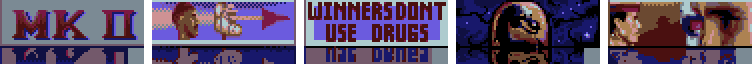

- **Super Nintendo: thirteen unused heads.** A published list shows seven heads with no description. The on-court head
  comes from the player struct (`$7E07C0` + `$100` per player; `+$D8` is the player ID, `+$DA` the head number × 32).
  The drawing code (`$80:B61C`, file `0x361C`) adds the animation frame to `+$DA` and reads a 16-bit frame address from
  the table at `$AA:AD82` (file `0x152D82`): 1,280 entries, 80 heads of 16 turning frames, `0x8B` bytes per frame. The
  DMA (`$80:DAFF`) takes the bank from `$0D23`, which follows the head: heads 0-13 are in bank `$3A`, 16, 17 and 25 in
  `$08`, 28 in `$1C`, 62-75 in `$46`, 76-79 in `$47`, and the rest each in their own place (19 in `$2B`, 33 in `$59`,
  46 and 50 in `$28`, 61 in `$58`). Heads 0-13 share their frame offsets with 62-75 (and 0-3 with 16, 17, 25, 28 and
  76-79), each copy in its own bank. Banks were read off `$0D23` in play for eight heads and fit that pattern.
  `tools/tests/snes_te_heads.lua` forced every player ID (`$00`-`$A9`; IDs from `$AA` read past the roster) into slot
  1 and read the head number at tip-off. Ordinary NBA players share stock heads (head 5 has 30 players, head 8 has 28);
  the secret characters and some players have their own. **Thirteen heads have no player: 0, 10, 12, 13, 17, 28, 29,
  63, 65, 67, 72, 73 and 77.** The published seven are 28, 63, 65, 67, 72, 73 and 77 (all 16 frames of each match its
  picture); 0, 10, 12, 13, 17 and 29 are new. Drawn here from the cart with the game's last sprite palette, the one
  the published picture uses; their skin tones in a game would come from whichever player wore them.

  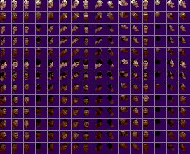

- **Genesis: fourteen unused heads** (not on any published list). The same scheme with its own numbering. Each player
  struct (`$FF4446` + `$14A` per player) holds a pointer at `+$58` into the frame table at `0x29C144`: 79 heads of 16
  long pointers (head × 64 + facing × 4), each to `0x8C` bytes whose first 128 are the uncompressed 2 × 2-tile sprite.
  Team pairs come from the word table at `0x2DC314`, through the team's offset at `0x2DC2DA` (code at `0x2A8A40`);
  Phoenix's first pair is at `0x2DC8CC`. `tools/tests/genesis_te_heads.lua` wrote every ID (`$00`-`$A9`) over Phoenix's
  first player in cartridge memory and read the pointer at tip-off. IDs from `$AA` read junk. Tyler, the cut IDs and
  the junk IDs get head 78. **Fourteen heads have no player: 10, 12, 13, 20, 23, 24, 26, 28, 33, 34, 42, 43, 44 and
  45.** The special heads pair up one-to-one with Super Nintendo heads through the shared IDs (Genesis 36-41 are
  Super Nintendo 18, 31, 19, 32, 20, 21, for example). The stock heads don't: Genesis heads 5, 7, 8 and 15-19 each
  cover more than one Super Nintendo head. So the two unused sets can't be matched up through the IDs. Drawn with the
  sprite palette at tip-off.

  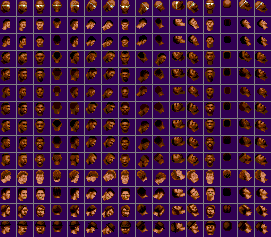

- **32X: four unused heads** (not on any published list). The 32X draws heads on its SH-2s from packed frames. Player 1's
  struct (`$FF6730`) holds a pointer at `+$58` into a table at cartridge `0x324F0` (`$8B24F0` to the 68000): 1,168
  SH-2 addresses (`$02xxxxxx`), 73 heads of 16 frames. Each frame is a width and height byte (`1F 1F`), then per row
  either `FF` (blank) or a start x, a count and that many 8-bit pixels. `tools/tests/32x_te_heads.lua` wrote every ID
  (`$00`-`$A9`) into team select's first slot (`$FF1F24`) and read the pointer at tip-off; IDs from `$AA` give a null
  pointer. 59 heads have a player. Of the other 14:
  - head 11 repeats head 0's pointers;
  - heads 10, 12-18 and 22 repeat a used head's first frames, and their later pointers lead to no frame (some land
    exactly 10 bytes before one), so they're broken entries, not heads;
  - **heads 9, 25, 32 and 72** are complete heads, 16 frames each, used by no ID.

  BizHawk doesn't show the 32X palette, so they're drawn with stand-in brown ramps (higher index darker).

  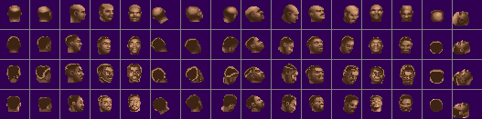

- **Genesis: unused music (not reproduced).** A published list gives tracks 80, 88 and 89. The game plays sounds by ID through a
  table at `$28B476` (8 bytes per ID; the last word is the song number for the GEMS-style driver at `$1F65DA`). Song
  numbers 80 and 88 put in every entry replaced only the logo jingle, with nothing musical (judged by ear); 89 crashed
  the emulator. Its numbers are probably counted differently, so the tracks weren't found.
- **Developer messages**, all present: "Snake Woz Ere!" (32X `0x341F8`), "I Love Emma Wadrop" (32X `0x3B9DC`), "I Luv
  Claire Reily" (Genesis `0x2AB374`), and the Super Nintendo's "SLICK/Audio v1.01 Copyright(C)1994 Bitmasters,Inc."
  (`0x17861B`) and leftover NBA Jam ending text (`0xD6A7A`).
- **Already on the codes page**: Kamm (VLK, Nov 9) on arcade, Kitzrow and Fox on Saturn, Stud Muffin's extra button
  hold, the three cut PlayStation characters, Steven Tyler's leftover entry.

## Portraits on the codes page

- **Super Nintendo** (original and TE): Mesen 2 with only BG1 shown (BG2 is the panel, the team logo is BG3 on TE and
  sprites on the original), cropped at x 8-56, y 112-168.
- **Genesis** (original and TE): BizHawk, each character on four teams, with and without plane B (the panel). The logo
  is sprites drawn behind the face, so a pixel is kept only if it's the same in all eight shots. Cropped at x 16-80,
  y 112-168.
- **Sega CD**: same as the Genesis (four teams, with and without plane B; the logo is on plane A here, beside the
  face), cropped at x 16-80, y 112-168.
- **PC**: DOSBox-X screenshots of each character on five teams, halved to 320x240. A pixel is kept if it's the same
  on all five and isn't a teal panel colour connected to the edge of the box. Cropped at x 16-80, y 112-168.
- **Arcade** (original and TE, for comparison): MAME 0.282. Each portrait is one blitter command (X `0x47`, Y `0x82`-`0x85`
  in the back buffer, command `0x8002`). A Lua write tap on the DMA registers clears that command's draw bits for a few
  frames, so the screen is drawn with the panel and logo but no face. The face is every pixel that differs from the
  normal frame, cropped at x 15-88, y 129-193.
- **Jaguar**: BizHawk, each character on six teams. Same method as the 32X (the panel is teal too). The player-1 marker
  drawn over the top of the slot is removed by position, cropped at x 20-84, y 116-172.
- **Game Boy** (original and TE): BizHawk with sprites turned off (LCDC bit 1 cleared each frame), kept as the full
  32x32 picture. The background is the same white as the faces' highlights, so it can't be cut out. Cropped at x 16-48,
  y 72-104 (TE) and x 24-56, y 72-104 with the frame (original).
- **Game Gear** (original and TE): BizHawk, with VRAM and CRAM dumped at team select and the screen redrawn from them
  (tile map at `$3800`, 4-bit tiles, BizHawk's CRAM as big-endian `0BGR` words). The redraw matches the screenshot in
  the portrait rows. A pixel is portrait if its tile uses the portrait's palette (sprite palette on the original,
  palette 0 on TE) and its colour index isn't 0. That keeps dark art: TE's palette has a second black (index 1) that
  Hugo uses a lot. Cropped at x 32-64, y 72-104 (original) and x 24-56, y 80-112 (TE).
- **Saturn**: BizHawk. The whole team-select foreground is drawn by VDP1, and its framebuffer stores colour codes
  rather than colours. Each portrait has its own colour bank (bank 3 for player 1; the logo is bank 1), and the panel is
  on VDP2, so the portrait is every framebuffer pixel in bank 3. Colours come from VDP2 colour RAM, and match the
  screenshot exactly (framebuffer offset +5, +8). Cropped at x 15-79, y 118-174 in framebuffer coordinates.
- **PlayStation**: BizHawk, GPU RAM dumped at team select. The player-1 portrait is an 8-bit texture at VRAM bytes
  1792-1856, rows 256-312, with its CLUT at (256, 496). Index 0 is transparent. The texture lines up with the face on
  the framebuffer with no colour conflicts, and its colours match that CLUT entry for entry.
- **32X**: BizHawk, each character on 14 team views (3 logos). A pixel is kept if it's the same on every team and isn't
  the panel's teal, cropped at x 16-78, y 112-168.

## Saturn and PlayStation: disc files

Every file on both discs was checked against the names the programs use (PlayStation `SLUS_000.02`, `MOVIE.EXE` and
`OVERLAY.BIN`; Saturn `0` and the other `.BIN` files):

- **Saturn: one dunk clip never named.** `DUK.BIN` lists the video clips (`\ZZ\WB2DUK.AVI` ... `\YY\AH1DUK.AVI`, two
  per team, plus `\END\END.AVI`). Phoenix has `PH4DUK.AVI` in the list but not `PH2DUK.AVI`, which is on the disc
  (`ZZ`) with nothing pointing to it. The other 54 clips are all listed.
- **PlayStation: two names don't match.** `MOVIE.EXE` lists 55 clips. For the Clippers it asks for `\2\LC3.STR` and
  `\2\LC2HALF.STR`, but the disc has `LC3HALF.STR` and `LC2.STR`. All the other names match.
- **PlayStation: `HIDDEN.BIN`** holds the secret-player portraits, including the three cut characters above.
- The PlayStation's `NEW1.RAW`-`NEW7.RAW` and `END.RAW` aren't named by any program because they're the CD audio
  tracks: the disc's track list puts track 2 at sector 70,731, where `NEW1.RAW` starts, and the eight files line up
  with tracks 2-9. The game plays music by track number. `END.RAW` (track 9) is the same length as `NEW1.RAW`
  (track 2), so it may be a repeat; the audio wasn't decoded.

The PlayStation clips play after a game: `MOVIE.EXE` (loaded at `$800A8000`) picks the winner's clip from a table of
55 names at `$800C7C64`, two per team, alternating between the two (`$800A93EC`), or a random one for the secret
teams. So a Clippers win asks for one of the two missing files. Its opener (`$800A9C48`) looks the name up on the
disc up to 10 times and, if it isn't there, cleans up and returns without playing anything, so a Clippers win just
skips the clip instead of crashing. The Japanese disc has `LC2HALF.STR` and `LC3.STR`, the names `MOVIE.EXE` asks for
(see [variants.md](variants.md)), so the US names are a mastering slip. Neither mismatch was checked in play.
