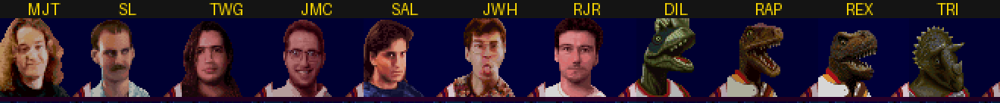

# Betas, prototypes and regional versions

Each was compared with the release it comes from: the secret-character tables (found by searching for the release
table's bytes, or for a table of the same shape), the text in the ROM or on the disc, and the file lists on CDs.

## NBA Jam, Super Nintendo

- **NBA Jam (Japan) (En) (Beta)** has an early secret table of 11 entries at file offset `0x153293` (`$2AB293`),
  checked at `$8AD294` by the same code as the release (initials at `$16F2`/`$16FA`/`$1702`, the release's
  `$16CC`/`$16D4`/`$16DC`, so most RAM is shifted by `$26`). Four of them are dinosaurs, the same four the Sega CD
  version has:

  | Initials | ID | Character |
  |----------|----|-----------|
  | `MJT` | `$36` | Mark Turmell |
  | `SL_` | `$37` | staff member |
  | `TWG` | `$38` | staff member |
  | `JMC` | `$39` | staff member |
  | `SAL` | `$3A` | Sal DiVita |
  | `JWH` | `$3B` | staff member |
  | `RJR` | `$3C` | Jamie Rivett |
  | `DIL` | `$3D` | dinosaur (a dilophosaurus) |
  | `RAP` | `$3E` | dinosaur (a raptor) |
  | `REX` | `$3F` | dinosaur (a T. rex) |
  | `TRI` | `$40` | dinosaur (a triceratops) |

  

  The hold rule is simpler than the release's: on the third initial, hold Start + X + L (`AND #$1060`) and press A,
  whatever the first initial is (the release picks the buttons by first initial, table `$2AF84C`). All 11 typed in
  Mesen 2 that way; each comes up at team select.
- **NBA Jam (USA) (Beta 2)** is the original release except for two bytes (file offset `0x7800`-`0x7801`).
- **NBA Jam XXXX (USA) (Proto)** has the release's secret table and Rev 1's text (its rebuilt multitap library); 120,549
  bytes differ from Rev 1. It wasn't gone through further.

## NBA Jam, Genesis and Game Gear

- **NBA Jam (USA, Europe) (Beta) (April, 1993)** has no secret-character table at all, and it has a "PASSWORD:"
  screen, which the release (it saves to EEPROM) doesn't.
- **Rev 1** adds a region lock (see [secrets.md](secrets.md)).
- **NBA Jam (Japan)** on Game Gear is Rev 1 with a Japanese header and two players' ratings changed (file offset
  `0x57CE7`); text and codes are the same.
- **Game Gear Rev 1** reads the console's region at boot (port `$00` bit 6, `$084B`) and leaves the ™ off the SEGA
  logo on a Japanese console. That's all it changes: with the check forced the other way in BizHawk, the logo loses
  its ™ and the legal screen after it is the same. The original Game Gear cart reads the same bit only at `$1E07E`,
  to pick one of two screen positions.

## Region checks

Every cartridge was searched for reads of the console's region: `$213F` on the Super Nintendo, `$A10001` on the
Genesis and 32X, port `$00` bit 6 on the Game Gear.

- **Super Nintendo:** NBA Jam and Tournament Edition (every revision and beta) never read it. Both Hang Time carts
  do; the US one shows its NTSC lockout screen on a PAL console (see [hangtime.md](hangtime.md#not-covered)).
- **Genesis and 32X:** NBA Jam Rev 1 has the lockout described in [secrets.md](secrets.md). Tournament Edition on
  Genesis (`$302`) and 32X (`$804`) runs the same standard check, but their headers list every region (`JUE`, and
  `F` on 32X), so it always passes. The original NBA Jam and both Tournament Edition carts also read the region to
  set a flag on European consoles (`$FF1D70` in NBA Jam). Hang Time on Genesis never reads it.

## Tournament Edition, Super Nintendo

- **Europe** and **Japan (En)** have the US secret table unchanged; the text differs only in the header and the
  Nintendo licence line.
- **USA (Beta)** has no secret table in either format the releases use. Its name list (`0x266E0D`) still has the
  staff from the release and 13 more who were later dropped (John Hey, Petro, John Newcomer, Oursler, Neil Hislop,
  Reeson Ivatts, Darren Falcus, Angela Atkinson, Ian McBurney, Ian Dunlop, Rob Gray, Gary Vine and Darren Hodgson),
  then nine placeholders, "ACCLAIM BLOKE 1" to "ACCLAIM BLOKE 9". In the release those slots hold Acclaim's staff and
  the extra characters (Asif Chaudhri, Brett Gow, Dan Feinstein, Eric Samulski, Alex De Lucia, Jay Moon, Eric Kuby,
  Larry Bird, the mascots, Bill Clinton, Prince Charles and Steven Tyler). The beta also has "PASSWORD:" text.

## Tournament Edition, PlayStation (Japan)

- The movie names are fixed: the disc has `LC2HALF.STR` and `LC3.STR`, exactly what `MOVIE.EXE` asks for, so the US
  disc's mismatch (it has `LC2.STR` and `LC3HALF.STR`) was a mastering slip.
- Seven CD audio tracks instead of eight (no `END.RAW`).
- The secret table in `OVERLAY.BIN` and `HIDDEN.BIN` (portraits, cut characters included) are the same as the US.
- The preset records keep END and FIN (January 1) and the same stats, but the other placeholders become in-jokes:

  | US | Japan |
  |----|-------|
  | END, FIN, CHR, DAZ, TOM, ZIG, MJT, CSR, JAY, HAR: "CHRIS KIRBY" | END, FIN, SNK, ZIG, CSR, DUS, HAR: "STEVE SNAKE" |
  | GJV: "GARY  VINE" | CHR: "BUG CREATOR!", FP: "FAYE IS COOL", KML: "ENTERPRISES!", EW: "FAT OLD COW!" |

  As in the US version, only END and FIN can be entered (the others are dated 99/99).

## Tournament Edition, Saturn (Japan)

Same secret table as the US disc (file `0`), and `DUK.BIN` still leaves out `PH2DUK.AVI`. The text is the same.

## NBA Jam, Sega CD (Japan)

Same 21 files and the same 28-entry secret table, dinosaurs included. `FRONT.BIN` and `QUARTER.BIN` are each 11,032
bytes larger, and `MAIN.BIN` 16 bytes larger; their English text is unchanged.

## Arcade revisions

Every arcade revision in MAME was compared with the next one: their text, and a disassembly diff (MAME 0.282's `dasm`)
narrowed to the routines whose code changed. Code and data move between revisions, so most of the raw diff is moved
data; the changes below are the ones that mean something. Secret characters and codes per revision are in
[arcade.md](arcade.md), [arcade_te.md](arcade_te.md) and [hangtime.md](hangtime.md).

- **NBA Jam prototypes (1.01 1/23/93, 2.00 1/24/93):** the same text apart from the version line. Their special
  thanks include Larry DeMar and spell "STEVEN HOWARD"; rev 1.00 drops DeMar and spells Stephen. Against rev 1.00
  (text and code), the prototypes have no operator message (1.00's "ENTER AN OPERATOR MESSAGE" screen), no "THIS
  GAME ACCEPTS DOLLAR BILLS" notice, no longest-winning-streak or hot-streak audits, no tank game, no end text for beating all
  27 teams, and no STARRING or PRODUCED BY pages in the credits (Steven Howard, Willie Morris Jr., Todd McClearn and
  Tony Scott are under a second SPECIAL THANKS). They do have the CREDIT LOW label ([arcade.md](arcade.md#unused-graphics));
  1.00 keeps the loop that started it but has a `NOP` where the prototypes branch to it (`FF8EECA0h`).
- **NBA Jam 1.00 → 2.00:** the end-of-game text for beating all 27 teams is rewritten (2.00 adds "stay in school!"),
  "YOUR DEAD!" becomes "YOU ARE DEAD!", and Tim Kitzrow joins the credits (Tony Scott and Willie Morris Jr. are already in 1.00's).
- **NBA Jam 2.00 → 3.01:** adds the computer-assistance and drone-difficulty settings, the hidden JAM INFO menu, and
  the power-up test switch setting; Michelle Brown leaves the credits and Frank Suareo joins.
- **TE prototype 2.00 → 1.00:** besides the location-test message ([arcade_te.md](arcade_te.md#match-up-codes)), the
  prototype's ending for beating every team is a placeholder: "Whoops, this is a test game and the end has not been
  programmed in yet. sorry!", then "We'll have a new challenge for you soon. We are updating this game every few
  days."
- **TE 2.1 → 3.0 2/26:** the backboard shatter and the left-hand side's Fatalities check are jumped over (the
  right-hand side's still works)
  ([arcade_te.md](arcade_te.md#backboard-shatter-revs-100-to-21)). The sound test's "RAIDEN (U13)" becomes "SHOES?
  (U13)", and the attract text "disallows any special guests" becomes "disallows any hidden features".
- **TE 3.0 2/26 → 3/04:** the challenge screen's "I DON'T THINK SO." becomes "WE DON'T THINK SO.", its "IT WASN'T
  THE SHOES." line is dropped, and the other Fatalities check is jumped over too.
- **TE Nani Edition (5.2 8/11/95):** adds network play ("Enter your scores in national tournaments via NANI Network
  for cash and prizes !"), a NANI UART test, nine game-speed settings instead of five, and six names to the credits
  (Dave DiGiorgio, Gary Pahlow, Mark Holobach, Matt Bolcer, Mike Lynch, Steve Benoit); Jamie Rivett is no longer in
  them. The backboard shatter is back on, and the uncensored "Get that shit outta here" is one of its random
  comments ([arcade_te.md](arcade_te.md#unused-commentary)).
- **NBA Hangtime L1.1 → L1.2:** L1.1 carries a "TOTAL CARNAGE TEAM:" list (Mark Turmell, John Tobias, Jim Gentile,
  Shawn Liptak, Jon Hey) that nothing points to, probably left over from Total Carnage's operator code. It also has
  text for a high-score reset option and for LOCKUPS and GAMES NOT FINISHED audits. L1.2 drops all of it and renames
  the test DIP switch from "UJ2 # 8" to "SW1 # 1".
- **NBA Hangtime and Maximum Hangtime, L and M:** each M revision has the same text as the L revision of the same
  date. The only code change is the number of saved player records: 195 instead of 410 (`$1E0` bits each from CMOS
  `@1408000h`). The M revisions are probably for boards with less CMOS memory; that's a guess from the numbers.
  Decoded and compared pixel for pixel, the images all six NBA Hangtime revisions point to are identical, and so
  are those of Maximum Hangtime's L1.0, M1.0 and L1.03.
- **Maximum Hangtime L0.9 → L1.0:** "CUSTOMISE" becomes "CUSTOMIZE", Dimitri leaves the thanks list and Kevin Day
  joins it, and "ALL NBA TEAM ROSTERS ACCURATE AS OF 11/1/96" is added.
